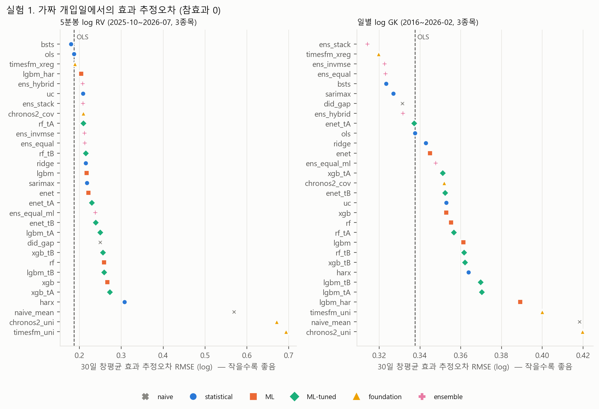
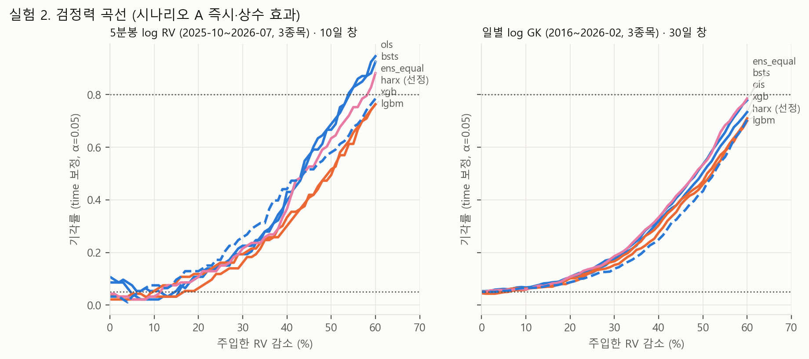
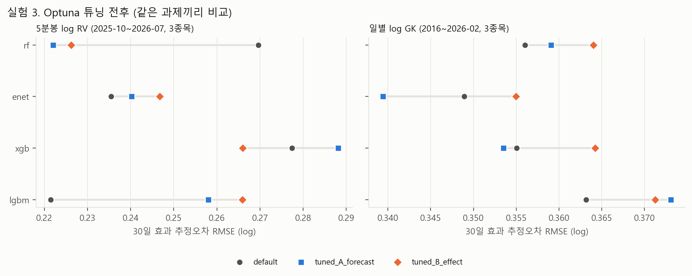
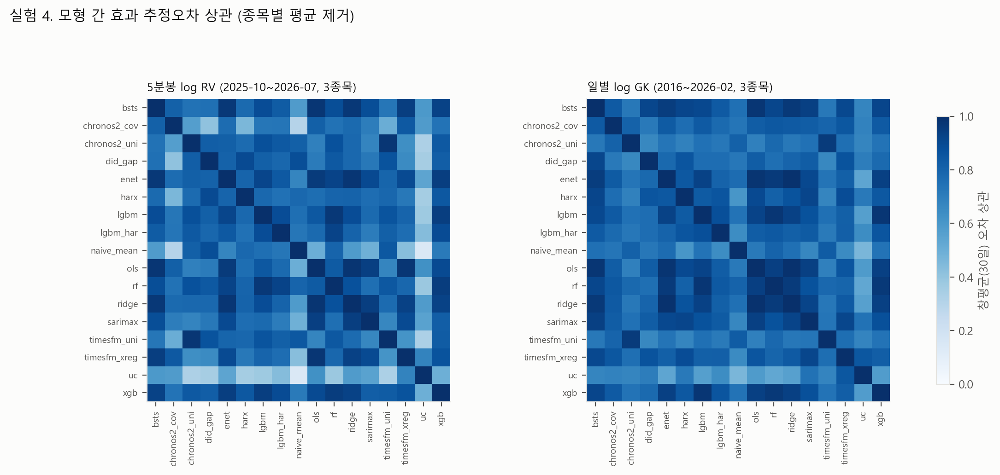
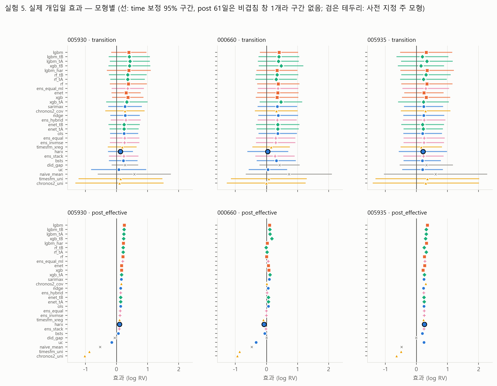

# RQ2 ML 확장 하위실험 — 결과 보고서

작성: 2026-11-16 · 코드: `src/rq2/ml_extension/` · 설정: [`config.yaml`](../config.yaml) · 로그: [`experiment_log.md`](experiment_log.md) · 환경: [`environment.json`](environment.json)

1차 RQ2 결과(`src/rq2/main_study/`)는 읽기만 했고, 바꾸지 않았다.
이 보고서의 숫자는 `results/tables/*.csv` 에서 그대로 옮겼다.

---

## 1. Executive Summary

**질문.** 1차 RQ2 반사실 모형에 ML(ENet·RF·LightGBM·XGBoost)과 foundation model(Chronos-2·TimesFM)을 넣어 실제로 얻는 이익이 있었나?

**답. 이 표본에서는 없었다.** 결과는 다섯 가지다.

1. **예측 (실험 1).**
   - rv5(5분봉) 30일 창에서 효과 추정오차가 가장 작은 모형은 BSTS(0.180)와 OLS(0.187)다.
   - 기본 ML 은 0.217~0.267 로 OLS 보다 16~43% 크다. 30일 창 DM 검정에서 OLS·BSTS 보다 유의하게 나은 ML 은 없다.
   - 일별 GK(2016~)에서는 stacking 앙상블(0.314)과 TimesFM+공변량(0.320)이 BSTS(0.323)보다 약간 낫다. 단독 ML(0.345~0.361)은 BSTS 보다 유의하게 나쁘다 (3종목 중 3종목, lgbm·rf·xgb).
2. **검출력 (실험 2).**
   - 어떤 모형도 RV −20% 를 검출하지 못한다. rv5 10일 창 검정력은 0.06~0.13 이다.
   - 최소 검출효과(MDE, time 보정, 3종목 평균)는 다음과 같다.

     | 창 | 통계 모형 | ML |
     |---|---|---|
     | rv5 10일 | −45% (OLS·BSTS) | −50~−54% |
     | gk 30일 | −59.5% (BSTS) | −62~−64% |

   - ML 을 넣으면 검출력이 오히려 떨어진다.
3. **튜닝 (실험 3).**
   - Optuna 중첩 CV 는 내부 검증에서 2~11% 이득을 보였지만, 밖으로는 옮겨지지 않았다.
   - 개선된 것은 rv5 RF 하나(0.270→0.222)다. LGBM 은 오히려 나빠졌다(0.221→0.258/0.266). GK 는 ±3% 안이다.
   - 튜닝 후 MDE 는 대부분 커졌다.
4. **앙상블 (실험 4).**
   - 모형 간 오차 상관이 0.89~0.97 로 높아 결합 이득이 작다.
   - 긴 GK 표본에서만 stacking 이 1위다. stacking 은 ML 에 거의 가중치를 주지 않았다 (rv5 rf 0.02·lgbm 0.05·xgb 0.06, gk lgbm·xgb 0.02).
5. **실제 효과 (실험 5).**
   - 사전 규칙으로 고른 HAR-X 의 추정치는 다음과 같다. Holm 보정 p 는 모두 1.0 이다.

     | 종목 | 창 | 효과 | p |
     |---|---|---|---|
     | 005930 | 시행 후 | +9.7% | space p 0.77 |
     | 000660 | 시행 후 | −7.3% | space p 0.80 |

   - 30개 모형 변형 어느 것도 유의하지 않다 (space p ≥ 0.10).
   - **1차 연구 결론("규제가 변동성을 낮췄다는 증거 없음")은 바뀌지 않는다.**

**논문에 쓸 수 있는 것.** ML 을 넣지 않은 이유에 대한 실증 근거가 생겼다. 근거는 세 가지다.

- 예측 이득이 없다.
- 검출력이 오히려 떨어진다.
- 튜닝 이득이 표본 밖으로 이전되지 않는다.

이와 함께, 이 표본 크기에서 검출 가능한 최소 효과가 **RV −45% 수준**이라는 검정력 공개도 쓸 수 있다.

---

## 2. Design

### 2.1 자료와 과제

과제 = (자료, 종목, 가짜 개입일). 가짜 개입일 이후 자료는 어떤 모형 입력에도 들어가지 않는다.

| 자료 | 결과변수 | 기간 | 학습창 | 가짜 개입일 | 과제 수 |
|---|---|---|---|---|---|
| `rv5` | 5분봉 log RV | 2025-10-01 ~ 2026-07-15 (발표 전날) | 확장 (≥ 90일) | 위치 90~186, 3일 간격 | 32 × 3종목 = 96 |
| `gk` | 일별 log Garman-Klass | 2015-06 ~ 2026-05 (상장 전) | 이동 250일 | 2016-06부터 10일 간격 | 238 × 3 = 714 (튜닝은 1/3인 240) |
| `space` | 5분봉 log RV | 실제 개입일 2026-07-16 | 확장 | 실제일 | donor 175 + 처치 2 + 음성통제 1 = 178 |

- 종목: 005930(삼성전자), 000660(SK하이닉스)는 처치, 005935(삼성전자우)는 음성통제다.
- 5분봉 RV 와 일별 GK 는 서로 다른 결과변수다. 표와 그림에서 섞지 않았다 (`dataset` 열).

### 2.2 모형 (30개 변형)

| 계열 | 모형 |
|---|---|
| naive | `naive_mean` (학습 평균), `did_gap` (donor 평균 + 학습기간 격차) |
| 통계 (1차 연구) | `ols`, `ridge`, `bsts`, `sarimax`, `uc`, `harx` |
| ML (1차 연구) | `enet`, `rf`, `lgbm`, `xgb`, `lgbm_har` (재귀 HAR 시차 추가) |
| ML 튜닝 | 위 4개 × 목적 A(일별 예측 MSE)·B(가짜개입 창평균 효과 MSE) = 8개 |
| foundation | `chronos2_cov`, `timesfm_xreg` (공변량), `chronos2_uni`, `timesfm_uni` (단변량) |
| 앙상블 | 동일가중(전체·ML만), 역MSE, stacking(비음수 ridge), hybrid(BSTS 0.5 + LGBM·XGB 0.25) |

- 통제변수 표준화·PCA·튜닝·앙상블 가중치는 그 과제의 학습구간 자료로만 정했다.
- 앙상블 가중치는 그 시점까지 이미 실현된 가짜 개입일 오차로만 학습했다.

### 2.3 평가

- **효과 추정오차.**
  - 정의: 창평균(실제 − 반사실). 참효과가 0인 가짜 개입일에서는 이것이 곧 효과 추정오차다.
  - 창: 5·10·20·30·61일.
- **합성 개입 (실험 2).**
  - 사후 y 에 효과를 주입했다: 0, −5, −10, −20, −30, −40% (log 척도 τ = ln(1+pct)).
  - 시나리오 5개: 즉시·점진(20일)·일시(반감기 10일)·상태 의존·고변동 한정.
  - 별도로 국내 통제로의 번짐(spillover)과 시차누출을 시연했다.
- **추론 3종.**
  - **native**: 모형 자체 구간.
  - **time**: 같은 종목의 다른 가짜 개입일 오차로 만든 귀무분포. 겹치지 않는 유효 창 수 n_eff 로 자유도를 잡았고, n_eff < 3 이면 검정 불가로 두었다.
  - **space**: 실제일 donor 순열.
- **사전 지정 선정 규칙 (실험 5).**
  - 실제 사후 효과를 보기 전에 `config.yaml` 에 고정했다.
  - 규칙: rv5, 005930·000660, time 보정 FPR ≤ 0.10 인 모형 중 보정 MDE 최소.
  - 원래 창은 30일이었다. 겹침 보정 후 검정이 불가능해 사전 지정 fallback 인 10일 창이 쓰였다 (§5.1).
  - 유의성: primary p = time p (가능하면), 아니면 space p. Holm 보정 대상은 2종목 × 2창이다.

### 2.4 재현성

- seed `20261116`. 각 실험 ID·설정·결과는 `experiment_log.{csv,md}` 에 11건 기록했다.
- 패키지 버전은 `environment.json` 에 있다 (Python 3.13.5, LightGBM 4.6.0, XGBoost 3.3.0, Optuna 4.9.0 등).
- 캐시는 `data/interim/rq_cache/ml_ext` 에 둔다. 완료된 과제는 다시 적합하지 않는다.
- 계산량: 기본 적합 5,160초, foundation model 2,345초, 튜닝 Optuna study 3,032개(× 30 trial)이다.

### 2.5 ML 학습 방법

코드: [`models.py`](../models.py), [`tuning.py`](../tuning.py), [`data_pipeline.py`](../data_pipeline.py), 1차 연구 [`core/models.py`](../../core/models.py).

#### (1) 무엇을 학습하나: 같은 날 통제변수 → 처치 종목 변동성

모든 ML 은 통계 모형과 **같은 문제**를 푼다. 학습구간에서 처치 종목의 log 변동성 y_t 를 같은 날 통제변수 X_t 에 회귀한다. 사후에는 실제 X 를 넣어 "규제가 없었다면"의 y 를 예측한다.

```
학습:  y_t = f(X_t) + e_t ,  t < i0 (가짜·실제 개입일 직전까지)
반사실: ŷ_t = f̂(X_t) ,       t ≥ i0 (사후 X 는 실제값, 사후 y 는 쓰지 않음)
효과:  창평균(y_t − ŷ_t)
```

- y 의 자기 시차를 쓰지 않는 직접(direct) 회귀다. 사후 y 는 처치에 오염되므로 시차로도 넣지 않는다. 예외는 `lgbm_har` 이고 아래 (3)에 따로 적었다.
- 각 과제(가짜 개입일 하나)마다 처음부터 새로 적합한다. 과제 사이에 모형이나 하이퍼파라미터를 공유하지 않는다.

#### (2) 입력 변수 X

| 자료 | 변수 | 학습구간에서만 추정하는 것 |
|---|---|---|
| rv5 | `C_main` 7개: donor 평균 log RV, donor PC2·PC3, KOSDAQ log RV, 미국 log VIX, \|SOX 수익률\|, 장 시작 지연일 더미 | donor PCA 의 표준화(평균·sd)와 고유벡터. 과제의 학습 마지막 날까지로 다시 추정한 뒤 전체 기간에 투영한다. |
| gk | 4개: donor 평균 log GK, 미국 log VIX, \|SOX 수익률\|, \|KOSDAQ 수익률\| | 없음 (PCA 미사용) |
| space | rv5 와 같다. donor 를 처치로 볼 때는 자기 자신을 뺀 donor 평균을 쓴다. | rv5 와 같다 |

- 모든 통제는 그날 장 마감 시점에 관측 가능한 값이다 (미국 값은 전날 밤 종가).
- ENet 은 파이프라인 안의 `StandardScaler` 를 학습구간으로만 적합한다. 트리 모형은 표준화하지 않는다.

#### (3) 모형별 학습 설정 (기본값 = 1차 연구 값, 튜닝 없음)

| 모형 | 구현 | 기본 하이퍼파라미터 | 비고 |
|---|---|---|---|
| `enet` | `ElasticNetCV` + 표준화 | α ∈ 10^[−4, 0] 25개, l1_ratio ∈ {0.1, 0.5, 0.9, 1} | α·l1_ratio 를 학습구간 안의 `TimeSeriesSplit(5)` 로 고른다. "기본"도 이 내부 CV 는 한다. |
| `rf` | `RandomForestRegressor` | 트리 300, max_depth 4, min_samples_leaf 10, max_features 0.6 | 학습 표본이 짧아 얕은 트리로 제한했다. |
| `lgbm` | `LGBMRegressor` | 트리 300, learning_rate 0.03, num_leaves 7, min_child_samples 15, subsample 0.8, colsample 0.8, λ 1.0 | 조기 종료 없음 (검증 구간을 따로 떼지 않음). |
| `xgb` | `XGBRegressor` | 트리 300, learning_rate 0.03, max_depth 2, subsample 0.8, colsample 0.8, λ 1.0 | 조기 종료 없음 |
| `lgbm_har` | LGBM (위 기본값) | 입력 = X_t + y 의 HAR 시차 (1일, 5일 평균, 22일 평균) | 학습은 실제 과거 y 로 한다. 사후에는 시차 자리에 **자기 반사실 예측값**을 재귀적으로 넣는다 (사후 y 미사용). 학습 첫 22일은 시차가 없어 뺀다. |
| `lgbm_lag_leaky` | `lgbm_har` 와 같음 | 같음 | **시연용 잘못된 설계.** 사후 시차에 관측된(효과가 들어간) y 를 넣는다. 결과 비교에는 쓰지 않는다. |

- seed 는 모두 `20261116` 이다.
- 트리 모형은 `n_jobs=1` 이다. 병렬은 과제 단위 joblib 11 프로세스로만 한다.

#### (4) 예측구간: 시계열 CV 잔차의 블록 부트스트랩

ML 은 자체 사후분포가 없으므로 1차 연구와 같은 방식으로 반사실 경로 2,000개를 만든다.

1. 학습구간을 확장창 5-fold 로 나눈다 (첫 학습 60일). 각 fold 마다 같은 설정으로 다시 적합해 표본 밖(OOF) 잔차를 모은다.
2. OOF 잔차에서 평균을 빼고, stationary block bootstrap(평균 블록 10일)으로 사후 길이만큼의 잔차 경로를 뽑는다. 평균을 빼므로 편향은 점추정에 남고, 구간에는 폭만 반영된다.
3. 반사실 경로 = 점예측 + 잔차 경로다.

- 이 구간이 진단 6·7 의 "native" 구간이다. 겹치는 OOF 잔차와 사후 구조 변화를 반영하지 못해 FPR 이 0.11~0.72 로 부풀었다.
- 그래서 검정에는 time 보정(가짜 개입일 오차 분포, n_eff)과 space 순열만 썼다 (§2.3).

#### (5) 튜닝 (실험 3: Optuna 중첩 시계열 CV)

바깥 루프는 실험 1 의 가짜 개입일 과제다. 안쪽 루프는 그 과제의 **학습구간 안에서만** 돈다.

- **안쪽 fold.**
  - 학습구간의 마지막 4개 연속 블록(각 20일)을 차례로 검증으로 쓰고, 그 앞 전부로 학습한다 (확장창).
  - 학습이 짧으면 블록 길이를 max(5, (n−40)/4) 로 줄인다.
  - 사후구간은 튜닝에 쓰지 않는다.
- **목적 함수.**
  - A (예측): 검증 블록의 일별 MSE 평균.
  - B (효과): 검증 블록 평균오차² 의 평균. 각 블록을 가짜 사후창으로 보고 효과 추정 MSE 를 직접 줄인다.
- **탐색.**
  - TPE sampler (seed 고정), 30 trial, 앞 10 trial 무작위.
  - trial 0 은 기본 하이퍼파라미터다. 그래서 "기본 대비 안쪽 개선"(inner_gain)으로 튜닝의 낙관 정도를 잴 수 있다.
- **탐색 범위.**

  | 모형 | 범위 |
  |---|---|
  | lgbm | 트리 50~600 (log), learning_rate 0.005~0.2 (log), num_leaves 2~31, min_child_samples 5~50, subsample·colsample 0.5~1, λ 10^[−3, 1] |
  | xgb | 트리 50~600, learning_rate 0.005~0.2, max_depth 1~5, min_child_weight 1~20 (log), subsample·colsample 0.5~1, λ 10^[−3, 1] |
  | enet | α 10^[−4, 0] (log), l1_ratio 0~1 |
  | rf | 트리 50~200 (계산비용 때문에 축소, §5.4), max_depth 2~10, min_samples_leaf 3~40, max_features 0.3~1 |

- **최종 적합.** 최적값으로 학습구간 전체를 다시 적합하고, (4)와 같은 방식으로 구간을 만든다. 이름은 `<모형>_tA`, `<모형>_tB` 다.
- **튜닝한 과제.**
  - rv5 96과제 전부.
  - gk 는 가짜 개입일 3개 중 1개 (240과제).
  - space 는 처치 3 + donor 40 (§5.2).

#### (6) 앙상블 가중치 학습 (실험 4)

- 가중치는 가짜 개입일 시점까지 **이미 실현된** 과거 과제의 일별 오차로만 학습한다. 미래 과제 정보는 쓰지 않는다.
  - 역MSE: 과거 일별 MSE 의 역수에 비례한다.
  - stacking: y ~ 구성원 예측을 비음수 ridge(α = 1, 절편 없음)로 학습한다.
- 과거 실현일이 30일 미만이면 동일가중으로 대체하고 그 비율을 기록했다 (rv5 12.5%, gk 0.8%).

#### (7) 정보 누출 점검

- 진단 1: 사후 y 를 무작위로 바꿔도 반사실 예측이 변하지 않는지 모든 모형에 대해 확인했다. `lgbm_lag_leaky` 만 실패했다 (의도된 결과).
- 통제 PCA 를 전표본으로 추정했을 때와 비교해도 결과 차이가 작았다 (`d01_pca_fullsample`).

---

## 3. Results

### 3.1 실험 1 — 반사실 예측 벤치마크



**30일 창평균 효과 추정오차 RMSE (log) — 가짜 개입일, 참효과 0**

| 모형 | rv5 | OLS 대비 | gk | OLS 대비 |
|---|---|---|---|---|
| bsts | **0.180** | 0.96 | 0.323 | 0.96 |
| ols | 0.187 | 1.00 | 0.338 | 1.00 |
| timesfm_xreg | 0.189 | 1.01 | 0.320 | 0.95 |
| ens_stack | 0.209 | 1.12 | **0.314** | 0.93 |
| enet | 0.221 | 1.18 | 0.345 | 1.02 |
| lgbm | 0.217 | 1.16 | 0.361 | 1.07 |
| rf | 0.258 | 1.38 | 0.355 | 1.05 |
| xgb | 0.267 | 1.43 | 0.353 | 1.05 |
| harx | 0.308 | 1.65 | 0.364 | 1.08 |
| naive_mean | 0.569 | 3.04 | 0.418 | 1.24 |
| chronos2_uni | 0.67 | 3.6 | 0.420 | 1.24 |

(rv5 n = 96, gk n = 714. 전체 순위는 `exp1_forecast_summary.csv`)

- **ML 이 이기지 못한다.**
  - 30일 창 DM 검정에서 OLS 나 BSTS 보다 유의하게(p < 0.05) 나은 ML·튜닝 ML 은 rv5·gk 어디에도 없다.
  - gk 에서 lgbm·rf·xgb·harx 는 3종목 모두 BSTS 보다 유의하게 나쁘다.
  - 유의하게 나은 것은 gk 의 `ens_stack` 하나다 (OLS 대비 2종목, BSTS 대비 1종목).
- **공통 편향.**
  - rv5 에서 모든 모형의 효과 추정치가 약 +0.12 (log) 위로 치우친다.
  - 주로 005930 때문이다 (진단 3, 편향 +0.2~0.3).
  - 2025-10 이후 대형주 RV 가 donor 평균보다 덜 오른 구조 변화로 보인다. 모형 선택으로 없어지지 않는다.
- **지평.** 창이 길수록 오차가 줄고 순위는 대체로 유지된다. rv5 61일 창에서 통계 모형과 ML 의 격차가 가장 작다 (그림 `exp1_effect_rmse_by_horizon`).
- **foundation model.**
  - 공변량을 쓴 TimesFM 은 통계 모형 수준이다.
  - 단변량 Chronos-2·TimesFM 은 수준을 맞추지 못해 naive 보다 나쁘다.
  - donor 정보 없이는 반사실이 안 된다.

### 3.2 실험 2 — 합성 개입: 회복·검정력·위양성·MDE



**최소 검출효과 (time 보정, 해석적, 검정력 0.8, 3종목 평균, RV %)**

| 모형 | rv5 10일 | rv5 20일 | gk 30일 |
|---|---|---|---|
| ols | −45.2 | −35 | −60 |
| bsts | −45.2 | −34 | −59.5 |
| timesfm_xreg | −46.1 | | −59.1 |
| ens_stack | −46.6 | | **−58.4** |
| enet | −46.8 | | −61.8 |
| rf | −53.1 | | −62.7 |
| lgbm | −51.5 | −38~−42 (ML) | −63.4 |
| xgb | −50.4 | | −62.4 |

(빈칸은 `exp2_mde.csv` 참조. rv5 20일은 일부 과제만 검정 가능해서 참고값이다.)

- **검정력.**
  - RV −20% 즉시 효과의 time 보정 기각률은 rv5 10일 창에서 0.06~0.13, gk 30일 창에서 0.08~0.11 이다.
  - 검정력 0.8 은 rv5 10일 창에서 약 −50~−55% 에서야 도달한다.
  - **1차 연구의 "효과 없음"은 "−20% 효과가 없었다"는 뜻이 아니라 "검출할 수 없었다"는 뜻이다.**
- **회복.**
  - 효과는 사후 y 에만 주입되므로, 모형의 효과 추정오차는 시나리오와 무관하게 실험 1 과 같다. 예: −40% 의 rv5 30일 RMSE 는 bsts 0.180, xgb 0.267.
  - 시나리오별로 달라지는 것은 창평균 참값의 크기다. 점진·일시 시나리오는 10일 창 참값이 작아 검정력이 0.02~0.10 으로 더 낮다.
- **위양성률 (진단 7, 명목 0.05).**
  - **native 구간은 쓸 수 없다.** rv5 30일 창 FPR 은 0.11~0.72 (harx 0.72), gk 30일은 0.12~0.31 이다.
  - **time 보정** 후 FPR 은 rv5 10일 0.02~0.12, gk 30일 0.03~0.06 이다.
  - **space 순열** FPR 은 0.046~0.05 이다.
  - ML 구간이 통계 모형 구간보다 특별히 더 나쁘지는 않다. 둘 다 보정이 필요하다.
- **space 순열 (공통 40 donor).**
  - 같은 40 donor 로 맞추면 −40% 검정력은 0.45~0.78 이다. bsts 0.65, ens_stack 0.65, timesfm_uni 0.78, lgbm 0.55, lgbm_tA 0.60, xgb 0.45.
  - 튜닝 ML 의 이점은 없다 (§5.2).
- **번짐 (시나리오 F).**
  - 효과의 50% 가 국내 통제(donor 평균·KOSDAQ RV)로 번지면 추정치가 감쇠한다. 감쇠율은 did_gap 0.50, bsts 0.48, ols 0.46, lgbm 0.36, rf 0.37, xgb 0.38 이다.
  - 트리 모형은 통제변수 변화에 덜 반응해서 감쇠가 작다. 그러나 정상 상황의 오차가 더 크므로 순이익은 아니다.
- **시차누출 시연.** 사후 실제 y 의 시차를 넣은 `lgbm_lag_leaky` 는 −20% 효과 회복률이 0.65 → 0.45 로 떨어진다. 사후 y 를 모형 입력에서 막아야 하는 이유다.

### 3.3 실험 3 — Optuna 튜닝



| 자료 | 모형 | 기본 | 목적 A | 목적 B | MDE 기본 → A / B |
|---|---|---|---|---|---|
| rv5 (72과제) | lgbm | **0.221** | 0.258 | 0.266 | −51.5 → −53.7 / −54.0 |
| | xgb | 0.277 | 0.288 | **0.266** | −50.4 → −54.4 / −54.0 |
| | enet | **0.235** | 0.240 | 0.247 | −46.8 → −46.9 / −49.0 |
| | rf | 0.270 | **0.222** | 0.226 | −53.1 → −50.9 / −53.0 |
| gk (240과제) | lgbm | **0.363** | 0.373 | 0.371 | −63.4 → −64.2 / −64.4 |
| | xgb | 0.355 | **0.354** | 0.364 | −62.4 → −62.4 / −63.5 |
| | enet | 0.349 | **0.339** | 0.355 | −61.8 → −61.0 / −62.6 |
| | rf | **0.356** | 0.359 | 0.364 | −62.7 → −62.9 / −63.4 |

(30일 효과 RMSE, MDE 는 rv5 10일·gk 30일 창. 비교는 튜닝한 과제끼리만이다.)

- **내부 CV 이득이 밖으로 이전되지 않는다.** 내부 검증 이득은 0.02~0.11 로 양수였다. 표본 밖에서 개선된 경우는 rv5 RF(−18%)와 gk ENet 목적 A(−3%)뿐이다.
- **효과 직접 최적화(목적 B)도 돕지 않는다.** 목적 B 가 기본보다 나은 경우는 rv5 xgb·rf 둘이다.
- **하이퍼파라미터 불안정.**
  - 과제마다 고른 값의 IQR/중앙값이 1을 넘는 경우가 흔하다 (`exp3_param_stability.csv`).
  - 목적 A 결과의 상대 분산(rel_spread)은 0.27~0.65 이다 (진단 8).
- **비용.** 과제당 튜닝 시간은 2초(enet)~91초(rf)로 기본 적합의 1~7배다.

### 3.4 실험 4 — 앙상블



- **오차 상관이 높다.** 30일 창 효과오차 상관은 bsts–ols 0.97, ML–bsts 0.89~0.97, lgbm–rf 0.97 이다. 가장 다른 오차를 내는 모형은 UC 다. 모형을 섞어도 공통 오차(구조 변화·donor 편향)는 남는다.
- **stacking 가중치** (학습 과제 평균):
  - rv5: ols 0.15, sarimax 0.14, bsts 0.14, … rf 0.02, lgbm 0.05, xgb 0.06.
  - gk: uc 0.20, sarimax 0.15, bsts 0.14, enet 0.13, lgbm 0.02, xgb 0.02.
  - 자료가 스스로 ML 을 거의 쓰지 않았다.
- **성능.**
  - gk 에서는 `ens_stack` 이 1위다 (0.314, OLS 대비 −7%, BSTS 대비 −3%).
  - rv5 에서는 모든 앙상블이 BSTS·OLS 보다 나쁘다 (0.208~0.237).
  - ML 만 섞은 `ens_equal_ml` 은 두 자료 모두 하위권이다.
- 앙상블의 이득은 "ML 의 이득"이 아니라 "통계 모형끼리 결합한 이득"이다.

### 3.5 실험 5 — 실제 개입일 재추정 (사전 지정 모형)



**선정.**

- 원래 창인 rv5 30일 창은 검정할 수 없었다 (검정 가능 과제 비율: 30일 0%, 20일 89%, 10일 100%). 그래서 fallback 10일 창이 쓰였다.
- 후보 30개 중 FPR ≤ 0.10 이면서 MDE 가 가장 작은 모형은 `harx` 다 (FPR 0.032, MDE 0.568 log).
- 2~5위는 ols (0.575), timesfm_xreg (0.577), did_gap (0.580), bsts (0.586) 다. ML 최상위인 enet 은 0.616 으로 11위다.

**주 모형 HAR-X 결과 (rv5).**

| 종목 | 창 | 효과 (RV %) | time p | space p | Holm p |
|---|---|---|---|---|---|
| 005930 | 전환 (발표~시행 10일) | +13.6 | 0.486 | | 1.0 |
| 005930 | 시행 후 61일 | +9.7 | — (유효 창 1개) | 0.773 | 1.0 |
| 000660 | 전환 | +4.3 | 0.715 | | 1.0 |
| 000660 | 시행 후 61일 | −7.3 | — | 0.795 | 1.0 |
| 005935 (음성통제) | 시행 후 61일 | +29 | — | 0.41 | |

- **모든 모형에서 비유의.** 30개 변형 전부 시행 후 space p ≥ 0.10 이다.
- **ML 은 더 위쪽으로 추정한다.**
  - ML 의 시행 후 추정치는 대체로 통계 모형보다 양(+)이다. 005930 lgbm 은 +0.25 log 다.
  - 단변량 FM·naive 는 큰 음수다 (chronos2_uni −1.0). 이것은 수준을 맞추지 못한 실패이지 효과가 아니다.
- **음성통제.** 005935 는 처치가 없는데도 모형 대부분이 +0.19~+0.35 (log) 를 낸다 (space p 0.19~0.99). 실제일 근처에 대형주 공통 충격이 있었다는 뜻이다.
- **종목 내 비교 (처치 − 음성통제).**
  - 시행 후 차이는 모든 모형에서 음수다 (−0.05~−0.17 log, bsts −0.13).
  - 다만 비겹침 창이 1개라 검정할 수 없다.
  - 1차 연구의 같은 기업 차분(상장기간 대비 post +0.02)과는 기준이 다르다. 여기서는 각 종목의 반사실 효과끼리 뺀 값이다. 두 정의의 차이는 표본 연장 후 함께 점검한다.
  - 전환 창 bsts p 는 0.609 다.
- **gk (일별, 긴 표본).**
  - 모두 비유의다 (harx 000660 시행 후 p 0.998, 005930 p 0.331).
  - ML 추정치가 더 양수다 (lgbm +42%).
- **1차 연구와 비교.** 1차 연구 BSTS 결과(005930 +0.05, 000660 −0.05, p 0.88/0.86)와 방향·크기·결론이 같다.

---

## 4. Diagnostics

| # | 진단 | 결과 | 판정 |
|---|---|---|---|
| 1 | 사후 정보 누출 (사후 y 교란 불변성) | `lgbm_lag_leaky`(의도적 누출)만 실패하고 나머지는 모두 불변이다. 전표본 PCA 는 결과를 거의 바꾸지 않는다 (`d01_pca_fullsample`). | 통과 |
| 2 | 과적합 (표본 밖/안 RMSE 비) | xgb 2.32, lgbm_har 2.02, lgbm 1.95, rf 1.39 이고 ols 는 1.17 이다. | ML 과적합 |
| 3 | 편향 (HAC) | 005930 은 모든 모형에서 +0.2~0.3 log 로 유의하다. 모형이 아니라 자료의 구조 변화다. | 공통 문제 |
| 4 | 잔차 자기상관 | 1차 자기상관 0.25~0.42, Ljung-Box 기각률 rv5 0.07~0.48 (단변량 FM·naive 최고)이다. 겹치는 창을 독립으로 보면 안 되는 이유다. | §5.1 로 보정 |
| 5 | 분포 이동 민감도 | 학습-사후 통제변수 이동이 클수록 오차가 커진다. 가장 민감한 것은 did_gap·harx 이고, chronos2_cov 가 가장 둔감하다 (기울기 0.017). | ML 이점 없음 |
| 6 | 구간 보정 | native 구간 포함률이 명목 미만이다 (gk 10일 bsts 0.80). time 보정 포함률은 0.95~0.96 이다. | time 보정 필요 |
| 7 | 위양성률 | §3.2. native 0.11~0.72, time 0.02~0.12, space ≈ 0.05 | time·space 만 사용 |
| 8 | 하이퍼파라미터 민감도 | 이득이 작고, 목적 A rel_spread 0.27~0.65 이다. | 불안정 |
| 9 | 기간 안정성 | rv5 전반부 1위는 did_gap, 3위는 lgbm 이다. 후반부에는 바뀐다. | 불안정 |
| 10 | 국면별 오차 | rv5 는 모든 변동·점프 국면에서 bsts·ols 가 ML 보다 낫다. gk 는 저변동 국면에서만 rf(0.323)·lgbm(0.329)이 bsts(0.327) 수준이고, 나머지 국면은 통계 모형이 낫다. 005930 편향은 모든 국면에서 나타난다 (`exp1_regime`). | ML 국면 이점 거의 없음 |
| 11 | 음성통제 | §3.5. 005935 +0.19~0.35, 비유의다. | 공통 충격 |
| 12 | 선택 편향 | rv5 30일 창에서 전반부 1위(did_gap)는 후반부 17개 중 13위다. 순위 상관은 0.40 이고, gk 는 0.79~0.91 이다. | 짧은 표본에서 모형 선택이 운에 좌우됨 |

**선택 분석.**

- **SHAP (lgbm, 실제일).** 시행 후 예측에 가장 크게 기여한 것은 `kosdaq_lrv` 의 이동(+0.13~+0.16)이다. ML 의 양(+) 추정은 KOSDAQ 변동성 변화에 대한 반응이다.
- **ablation (rv5 30일).**
  - donor 를 빼면 RMSE 가 +43~69% 늘어난다.
  - KOSDAQ·미국 변수를 빼면 −8~+35% 로 변화가 작고, rf 만 크다.
  - 반사실의 정보는 대부분 donor 평균에서 온다.

---

## 5. Failed / Problems (실패와 수정 기록)

각 항목은 문제 → 원인 → 영향 → 수정 → 전후 → 남은 한계 순서다. 실험 로그 ID 를 같이 적었다.

### 5.1 time 보정 귀무분포가 겹치는 창을 독립으로 취급 (`RQ2-ML-FAIL-TIMENULL-OVERLAP`)

- **문제.**
  - rv5 가짜 개입일은 3일 간격이고 평가창은 30일이라, 인접 창이 90% 겹친다.
  - 처음에는 32개 창을 독립 표본으로 보고 t 분포 자유도를 31로 잡았다.
- **영향.** 귀무분포 폭을 과소추정해 FPR 이 부풀었다. 그런데도 선정 규칙은 그대로 통과했다.
- **수정.**
  - 비겹침 유효 창 수 n_eff 로 자유도를 잡았다. n_eff = (가짜 개입일 범위 + 창 길이) / 창 길이.
  - n_eff < 3 이면 검정 불가로 두었다.
  - 결과 rv5 n_eff 는 5일 15, 10일 6.8, 20일 2.9, 30일 1.5, 61일 0 이다.
- **전후.**
  - rv5 30일 창 time 검정이 불가능해졌다 (이전에는 모든 모형이 "검정 가능").
  - 실제일 시행 후 61일 창은 time 검정 불가가 되어 space 순열로 대체했다.
- **규칙 이탈 공개.**
  - 사전 지정 창(30일)에서 선정할 수 없게 되어, `fallback_windows: [h20, h10, h5]` 를 **사후에** `config.yaml` 에 추가했다.
  - 이 추가는 실제 사후 효과를 보기 전에 했고, 가짜 개입일 결과만 썼다. 그래도 사전 지정에서 벗어난 것이므로 공개한다.
  - fallback 결과 10일 창에서 harx 가 선정됐다.
- **남은 한계.** 이 표본(가짜 개입일 범위 96일)에서는 30일 이상 창의 time 검정이 원리적으로 불가능하다. 2027-01 표본 연장 후 다시 본다.

### 5.2 space 순열의 donor 수 불일치 (`RQ2-ML-FAIL-SPACE-DONOR-MISMATCH`)

- **문제.** 튜닝 ML 의 space −40% 검정력이 0.45~0.60 으로, 기본 ML(0.21~0.26)보다 훨씬 좋아 보였다.
- **원인.** 튜닝 비용 때문에 space 튜닝은 처치 3 + donor 40 에서만 했다 (§5.3). 다른 모형은 donor 175개로 순열했다. 단위 수가 다른 순열을 비교한 것이다.
- **수정.** 같은 40 donor 로 모든 모형을 다시 순열했다 (`exp2_space_permutation_common40.csv`).
- **전후.** 모든 모형이 0.45~0.78 이 되었다 (bsts 0.65, lgbm 0.55, lgbm_tA 0.60). **튜닝 이점은 착시였다.**
- **남은 한계.** 40 donor 순열은 p 값 해상도가 1/41 이다.

### 5.3 space 튜닝 정지 (`RQ2-ML-FAIL-SPACE-TUNE-HANG`)

- **문제.** space enet_tB 가 2시간 동안 진행되지 않았다.
- **수정.** 해당 실행의 프로세스 트리만 종료하고 `--stages tune` 으로 캐시에서 재개해 완료했다. `run.log` 에 재시작 시각을 남겼다.
- **추가 사고.** 실행 중 `run.log` 를 sed 로 고쳐 로그 핸들이 끊겼다. 누락된 완료 줄 2개는 수동으로 보충했고, 보충했다고 적어 두었다.
- **영향.** 결과에는 없다 (캐시는 과제 단위).

### 5.4 그 밖의 문제

| 문제 | 영향 | 처리 |
|---|---|---|
| rv5 첫 가짜 개입일 60에서 1차 연구 core 의 OOF 잔차 fold 가 비어 적합 실패 | 초기 과제 일부 결측 | `first_cutoff` 90 으로 올림. 과제 수 감소 (32 × 3) |
| gk 가짜 개입일 248 < 학습창 250 버그 | 학습창 미달 과제 생성 | 첫 개입일 = max(2016-06-01 위치, 학습창 250) 로 보장 (`data_pipeline.py`) |
| RF n_estimators 탐색 50~500 이 gk 240 과제에서 비용 과다 | 튜닝 수 시간 지연 | 50~200 으로 축소 (로그 설정에 기록) |
| 번짐 시나리오에서 통제 PCA 축 자체는 이동하지 않음 (학습창 고정) | 번짐이 PCA 점수로만 들어감 | 의도된 설계로 두고 한계에 기록 |
| foundation model 은 창 단위 구간이 없음 | native FPR·포함률 NaN | time·space 보정으로만 평가 |
| **선정 역설**: harx 는 30일 창 RMSE 가 rv5 최하위권(0.308)인데 선정됨 | 편향은 크지만 분산이 작아 10일 창 MDE 가 최소 | 규칙대로 유지·공개. 결론은 2위 이하(ols·bsts) 모형과 같음 |
| 선택 불안정 (진단 12) | 짧은 표본에서 "최고 모형"이 우연 | 사전 규칙을 쓴 이유. 모든 모형 결과를 함께 보고 |
| E2 실험 로그에 rv5 30일 MDE 가 NaN 으로 기록 | 로그 요약 무의미 | 검정 가능한 창(rv5 10일)으로 수정 |

---

## 6. Interpretation

세 질문을 섞지 않는다.

**(1) 예측: ML 이 반사실을 더 잘 맞추나? — 아니다.**

- rv5(약 190일)에서 ML 은 OLS·BSTS 보다 16~43% 나쁘다. 과적합 비는 1.4~2.3 이다.
- gk(10년)에서도 단독 ML 은 BSTS 보다 유의하게 나쁘다.
- 반사실 정보의 대부분은 donor 평균이 주는 선형 관계다 (ablation). 비선형 구조로 더 얻을 것이 없다.

**(2) 식별: ML 이 효과를 더 잘 분리하나? — 아니다.**

- 모든 모형의 오차는 공통 성분(005930 편향, 대형주 공통 충격)이 지배한다 (오차 상관 0.89~0.97).
- ML 은 통제변수(KOSDAQ RV) 변화에 더 크게 반응해 실제일 추정치를 위로 민다 (SHAP).
- 번짐 상황에서 트리 모형 감쇠가 작은 것은 장점이다. 그러나 정상 상황 오차가 더 커서 상쇄된다.
- 식별을 위협하는 것은 모형 선택이 아니라 음성통제 +0.2~0.35 로 드러난 공통 충격이다.

**(3) 유의성: ML 이 검출력을 높이나? — 아니다. 낮춘다.**

- time 보정 MDE 는 ML 이 통계 모형보다 5~9%p 크다.
- 튜닝은 MDE 를 더 키운다.
- 어떤 모형으로도 −20% 는 검출할 수 없다 (검정력 ≤ 0.13).
- 그래서 1차 연구의 비유의는 "효과가 없다"가 아니라 "이 자료로는 −45% 미만 효과를 구분할 수 없다"로 읽어야 한다.

**정리.** ML 을 넣어 얻은 순이익은 없다. 이득처럼 보였던 것(space 튜닝 검정력, 내부 CV 이득)은 모두 비교 조건이 달라서 생긴 착시이거나 표본 밖으로 이전되지 않았다.

---

## 7. Implications (논문 반영)

1. **본문 모형은 BSTS/OLS 를 유지한다.** ML 은 부록 강건성으로 내린다. 근거로 실험 1·2의 표를 인용한다.
2. **검정력과 MDE 를 본문에 공개한다.** 다음 문장을 넣는다: "이 표본에서 0.8 검정력으로 검출 가능한 최소 효과는 RV 약 −45%(10일 창)이며, 시행 후 61일 창은 비겹침 가짜 개입일이 1개뿐이라 시간 기반 추론이 불가능하다."
3. **추론은 space 순열과 time 보정(n_eff)으로 한다.** 모형 자체 구간은 FPR 이 최대 0.72 라 쓰지 않는다.
4. **음성통제(005935)와 종목 내 비교를 함께 보고한다.** 처치 − 음성통제 차이가 모든 모형에서 음수(−0.05~−0.17)라는 점은 표본을 늘린 뒤 가장 먼저 다시 볼 신호다.
5. **"ML 이 왜 도움이 안 되나"를 한 단락으로 쓸 수 있다.**
   - 짧은 표본: 과적합 비 2배.
   - 선형 donor 정보가 지배적이다.
   - 오차 공통 성분이 크다.
   - 튜닝 이득이 이전되지 않는다.

---

## 8. Limitations

- rv5 표본은 약 190일로 짧다. 가짜 개입일 범위가 96일이라 30일 이상 창의 time 검정이 불가능하다.
- 처치 종목 2개, 음성통제 1개다. space 순열은 donor 와 처치의 교환 가능성을 가정한다.
- gk 는 다른 결과변수(일별 OHLC)다. rv5 와 직접 비교하지 않고 방향만 참고한다.
- 튜닝 탐색은 30 trial 이고, gk 는 과제 1/3 만 튜닝했다. 더 넓은 탐색이 이득을 낼 가능성은 남는다. 다만 내부 CV 이득이 이전되지 않은 패턴상 크지 않을 것으로 본다.
- foundation model 은 zero-shot 만 썼다 (미세조정 없음).
- 선정 규칙의 창 fallback 은 사후 추가다 (§5.1).
- 번짐 시나리오는 통제변수 2개, 비율 50% 만 봤다.

---

## 9. Future

1. **표본 연장 (최우선).**
   - 2027-01 까지 분봉을 다시 모으면 시행 후 창이 길어지고 rv5 n_eff 가 늘어 30일 창 time 검정이 가능해진다.
   - `config.yaml` 의 날짜·창만 바꾸고 캐시를 지운 뒤 `run_all` 을 다시 돌린다. 선정 규칙은 바꾸지 않는다.
2. **공통 충격 통제.** 음성통제 +0.2~0.35 의 원인(대형주 요인, 반도체 업황)을 donor 가중이나 요인 통제로 분리한다.
3. **종목 내 비교의 검정 가능화.** 표본 연장 후 처치 − 음성통제 차이를 time 보정으로 검정한다.
4. **해외 ETF (가장 나중).** 자료 확보 후 space donor 를 넓힌다.
5. ML 은 표본이 늘어도 위 1~3을 바꿀 가능성이 낮다. 같은 코드로 재확인만 한다.
