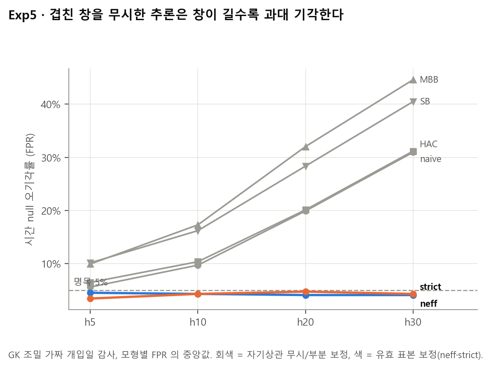
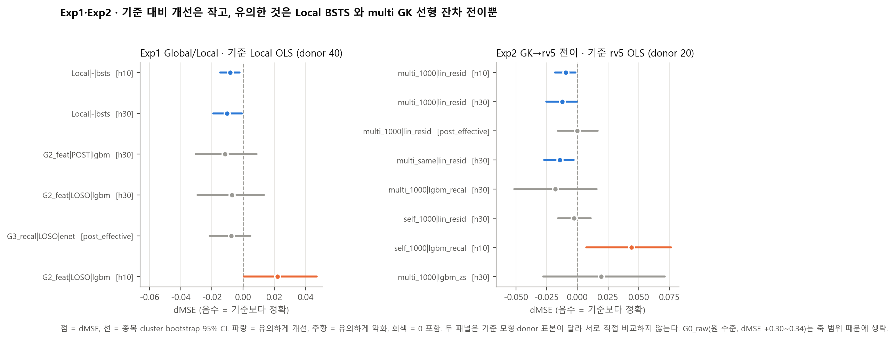
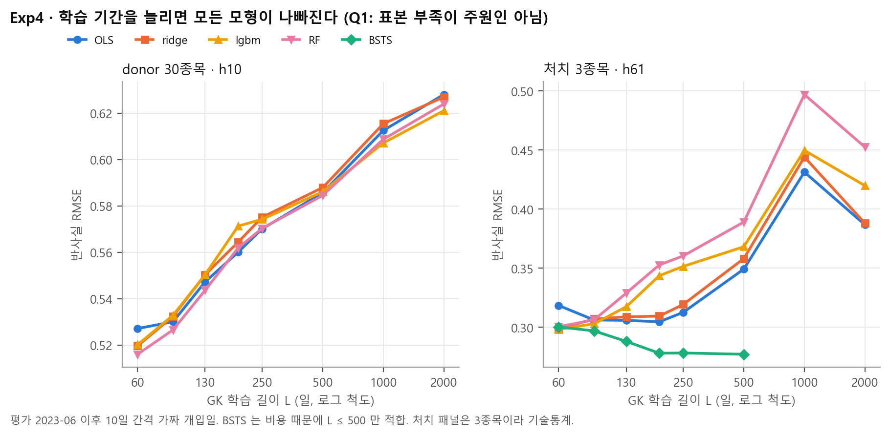
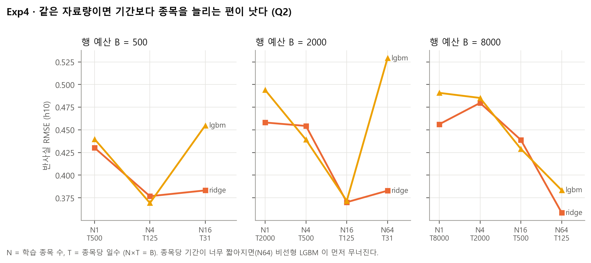
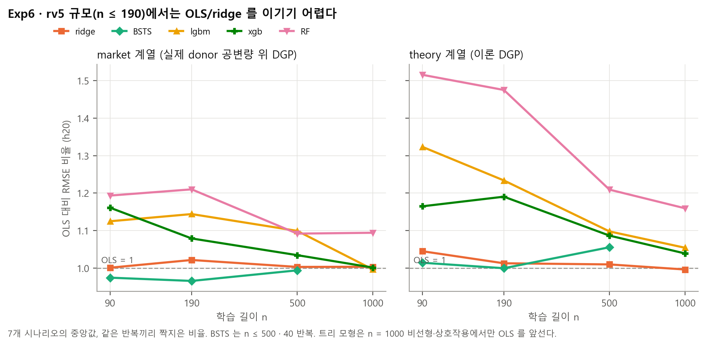
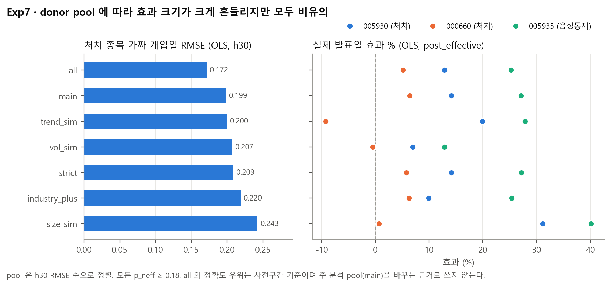
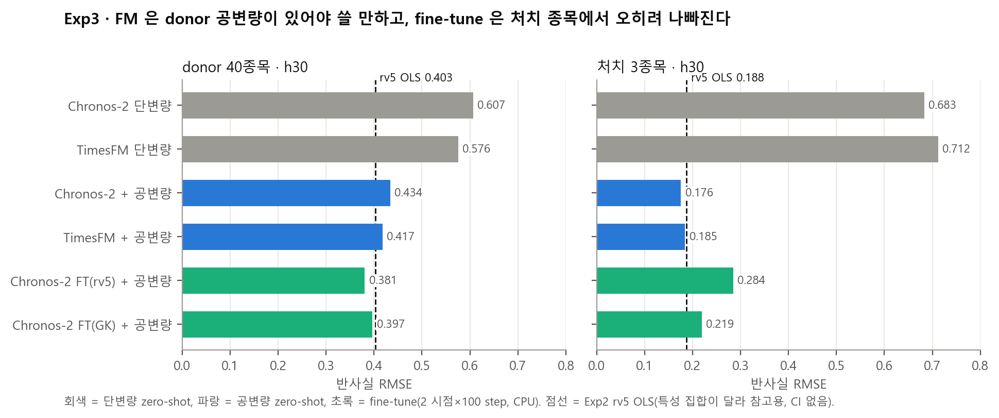

# RQ2 ML 후속 실험 보고서 (ml_followup)

작성: 2026-11-17 · 코드 기준 커밋 `8214a77`(rq2 브랜치, 후속 실험 코드는 미커밋) · seed 20261117
범위: 1차 RQ2 주 분석(`main_study`)과 1차 ML 확장(`ml_extension`) 결과는 **읽기만** 했고 변경하지 않았다.
모든 수치는 `results/tables/*.csv` 에서 다시 확인할 수 있고, 그림은 `py -3.13 -m src.rq2.ml_followup.figures` 로 표에서 다시 그린다(`results/figures/`). 사후 모형 선택은 하지 않았고, 불리한 결과도 그대로 적었다.

---

## 0. 요약 — 무엇이 반사실 정확도·신뢰도를 실제로 개선했나

| 전략 | 정확도 효과 | 신뢰도(추론) 효과 | 판정 |
|---|---|---|---|
| 추론 방식 교정 (neff·strict 시간 null) | – | naive/HAC/MBB/SB 의 FPR 13~44% → neff·strict ≈ 1~10% | **가장 중요. 필수** |
| Local BSTS | donor dMSE −0.008(h10)·−0.010(h30), cluster CI 0 미포함 | FPR 정상 | 작지만 유일하게 유의한 Local 개선 |
| 종목 수 확대 (같은 행 예산에서 N↑, T↓) | B=2000 행에서 RMSE 0.46~0.49 → ≈0.37, bias 감소 | – | 도움 됨 (Q2) |
| GK→rv5 선형 잔차 전이 (`multi\|lin_resid`) | donor h10·h30 dMSE −0.009~−0.014, CI 0 미포함(경계선), post_effective 이득 없음 | FPR 정상(h10) | 작게 도움. 처치 3종목에선 오히려 악화 |
| 넓은 donor pool (`all`, 204종목) | 처치 의사 예측 RMSE 가장 낮음 | 비유의 결론 불변 | 민감도로만 보고 (사후 선택 금지) |
| Global/Pooled ML (G0~G3) | Local OLS 대비 유의한 개선 없음 | 실제 효과 더 크게 추정되나 모두 비유의 | 도움 안 됨 |
| 복잡한 ML (LGBM/XGB/RF, 깊은 트리, 튜닝) | 실데이터 OLS 대비 0.98~1.17배, 시뮬레이션도 n≤190 에서 7~80% 악화 | – | 도움 안 됨 |
| 학습 기간 연장 (GK 60→2000일, 자기 종목 GK 전이) | 오히려 악화 (구조 변화) | – | 도움 안 됨 (Q1) |
| Foundation model zero-shot (+donor 공변량) | 처치 종목에서 OLS 와 비슷하거나 약간 우수, donor 긴 창에선 열위 | FPR 정상 | 동일 조건 CI 없음 → 우열 주장 안 함 |
| Foundation model fine-tune | donor 에서만 개선, 처치 종목에선 zero-shot 보다 악화 | – | 도움 안 됨 (과적합 의심) |

**결론.** 이번 후속 실험에서 반사실 *신뢰도* 를 크게 바꾼 것은 알고리즘이 아니라 **추론 방식**(유효 표본 수 보정)이었다.
*정확도* 개선은 Local BSTS, 종목 수 확대, GK 선형 잔차 전이에서만 작게(3~5%) 확인되었다.
"더 복잡한 모형"과 "더 긴 기간"은 어느 쪽도 일관되게 도움이 되지 않았다.
어떤 전략에서도 RQ2 실제 발표일 효과는 타당한 추론에서 유의하지 않다. **따라서 RQ2 주 결론(유의한 효과 없음)은 유지된다.**

---

## 1. 공통 설계

- **표적·과제.** rv5(5분 수익률 실현분산, 정규장 1분봉에서 산출)의 처치 2종목(005930, 000660)과 음성통제 1종목(005935)을 쓴다.
  - 가짜 개입일은 위치 90~186, 3일 간격으로 32개이고, 실제 개입일은 위치 190(2026-07-16 발표)이다.
  - donor 가짜 개입일 평가에는 무작위 40종목을 쓴다(seed 고정).
- **창(window).** h5·h10·h20·h30·h61, transition=[0,10), post_effective=[10,71).
  - 오차는 err = 창 평균 실제 − 창 평균 예측 (log 척도)이다.
- **지표.** CF RMSE/MAE/bias, 같은 표본 LOO FPR(neff·strict), 효과 bias·power·coverage(시뮬레이션), 실제 효과(%)와 p를 본다.
  - 비교는 Local OLS 대비 dMSE에 **종목 단위 cluster bootstrap CI**(999회)를 붙여서 한다.
- **누수 방지.**
  - 처치 종목의 사후 y는 어떤 학습에도 넣지 않았다.
  - donor 선정·종목 특성은 사전구간으로만 계산했다.
  - GK 사전학습은 각 평가 시점(d0) 이전 자료만 썼다.
  - donor 사후 행을 쓰는 경우(Exp1 `POST`)는 민감도로만 분리 보고한다.
- **해석상 주의.** bootstrap 반복 수는 독립 관측치 수가 아니다.
  - rv5 가짜 개입일 32개는 3일 간격으로 겹쳐 있어, 유효 표본은 h10 ≈ 6.8개, h30 ≈ 1.5개, post_effective ≈ 0개다.
  - 그래서 **h30 이상에서는 처치 종목 FPR 을 검정할 수 없다**(`testable_share = 0`). 이 창의 정확도 비교는 기술통계일 뿐이다.

---

## 2. Exp5 — 통계적 추론 감사 (우선순위 1)

표: `exp5_time_null_loo_rv5`, `exp5_time_null_audit_gk`, `exp5_real_effect_before_after`, `exp5_space_*`, `exp5_selection_*`, `exp5_exchangeability_treated_pctile`

**1) 시간 null FPR.** rv5 LOO, 모형 중앙값, 명목 5% 기준이다.

| 방법 | h10 | h20 | h30 |
|---|---|---|---|
| naive | 0.134 | 0.179 | 0.243 |
| HAC | 0.145 | 0.208 | 검정 불가 |
| MBB | 0.177 | 0.285 | 검정 불가 |
| SB | 0.172 | 0.236 | 검정 불가 |
| **neff** | 0.081 | 0.014 | 검정 불가 |
| **strict** | 0.097 | 0.049 | 검정 불가 |

- GK 조밀 감사(블록 수십 개)에서는 neff·strict 의 FPR ≈ 4% 이고, naive/HAC/MBB/SB 는 h30 에서 30~44% 였다.
- 겹친 창의 자기상관을 무시하는 방법은 크게 과대 기각한다. 1차 확장의 neff·strict 선택은 타당했다.

**2) MDE 과소추정.**
- 1차 확장의 2.8·s0 MDE 는 실제 표본 외 오차 sd 를 과소추정한다(예: h30 s0 0.25 vs 실제 0.48).
- 실제로 탐지 가능한 효과 크기는 약 70~85% 수준이다. −20% 효과는 사실상 탐지할 수 없다.

**3) 모형 선정 규칙 감사.**
- "h10 MDE 가 가장 작은 모형"을 고르는 규칙은 다음 블록 성능과의 순위상관이 ≈ 0.04 로, 사실상 무작위다.
- 1차 확장에서 이 규칙으로 고른 harx 는 긴 창에서 오히려 최악이었다. 1차 확장의 harx 기반 서술은 이 한계를 달고 읽어야 한다.

**4) 공간(space) 순열.**
- 처치 종목은 시가총액·R² 가 donor 분포 최상위라 donor 와 교환가능하지 않다.
- 공간 순열 p 는 보수적이다(크기 과소, 검정력 낮음).

**5) 실제 효과 before/after.** 타당한 방법(neff, strict, GK 보정, space)에서는 모든 모형·창에서 비유의다. → **RQ2 결론 유지.**

---

## 3. Exp1 — Global/Pooled 학습 (우선순위 2)

표: `exp1_global_accuracy`, `exp1_global_dmse_vs_local_ols`, `exp1_global_per_code`, `exp1_global_k_curve`, `exp1_panel_design_effect`, `exp1_global_fpr_loo`, `exp1_global_real_effect`, `exp1_post_sensitivity_real`

**변형.**
- G0_raw: 원 수준
- G1_norm: 종목별 표준화
- G2_feat: G1 + 사전구간 종목 특성
- G2_id: G2 + 종목 ID
- G3_recal / G3_resid / G3_boost: 표적 사전자료로 국소 적응

학습 방식은 LOSO, INCL, POST(민감도) 세 가지다.

**Donor 40종목, Local OLS 대비 dMSE** (cluster CI):

| 창 | 가장 좋은 항목 | dMSE [95% CI] | 이긴 종목 비율 |
|---|---|---|---|
| h10 | Local BSTS | −0.008 [−0.015, −0.002] | 65% |
| h30 | G2_feat\|POST\|lgbm | −0.012 [−0.030, 0.009] | 58% |
| h30 | Local BSTS | −0.010 [−0.019, −0.001] | 63% |
| post_effective | Local ridge | −0.010 [−0.038, 0.011] | 50% |
| post_effective | G3_recal\|LOSO\|enet | −0.008 [−0.021, 0.005] | 65% |

- **유의한 개선은 Local BSTS 뿐이다.** Global 변형은 최선의 경우에도 CI 가 0 을 포함하고, 이긴 종목 비율은 50~67% 다.
- G0_raw(원 수준)는 donor 에서 최악이었다(dMSE +0.30 수준). 그런데 처치 post_effective 에서는 좋게 나왔는데(0.104), 우연 또는 과적합으로 본다.
- **K 곡선.** Global LGBM h10 RMSE 는 K 를 10 → 175 로 늘리면 0.386 → 0.351 로 개선되지만, Local 보다는 여전히 나쁘다.
  - 처치 종목 bias 약 +0.18 은 K 를 늘려도 남는다. 처치 대형주가 donor 분포 밖에 있기 때문이다(Exp5-4 와 일관).
- **설계 효과.** donor 간 잔차 상관 ≈ −0.003, 설계 효과 ≈ 0.5 다.
  - 다만 표본 내(in-sample) G2 LGBM 잔차로 계산했고 종목 내 자기상관을 무시했으므로, "패널이 독립 관측치를 늘린다"는 근거로 쓰면 안 된다.
- **처치 FPR.** h10 neff·strict 4~9% 이고, h30 이상은 검정 불가다.
- **실제 효과.** Global 모형은 효과를 더 크게 추정한다(transition +45~125%). 그러나 모든 p 가 space ≥ 0.057, 시간 > 0.1 이다.
  - POST(donor 사후 행 사용)는 효과를 10~20%p 바꾸지만 결론은 같다.

---

## 4. Exp4 — 표본 효율 (우선순위 3)

표: `exp4_rv5_length_curve`, `exp4_gk_length_curve`, `exp4_nt_budget`, `exp4_q5_min_length`

**rv5 이동창 길이** (평가 가짜 개입일 ≥ 130 고정, RMSE):

| 집단 | 창 | L=45 OLS | L=130 OLS | L=45 ridge | L=130 ridge | 확장창 OLS |
|---|---|---|---|---|---|---|
| donor | h10 | 0.380 | 0.413 | 0.365 | 0.418 | 0.415 |
| treated | h10 | 0.332 | 0.299 | 0.306 | 0.315 | 0.293 |
| treated | h30 | 0.245 | 0.223 | 0.228 | 0.260 | 0.210 |

- 길이를 늘려도 단조롭게 개선되지 않는다. 처치 종목은 3개, 과제 수는 적어 길이 간 차이는 잡음 수준이다.

**GK 학습 길이 60 → 2000일** (donor 30종목 + 처치 3, 평가 2023-06 이후 10일 간격):
- 모든 모형에서 길이가 길수록 RMSE 가 **증가**한다. donor h10 OLS 는 0.527 → 0.628, 처치 h61 OLS 는 0.318 → 0.387 이다.
- donor 에서 ML/OLS 비율은 모든 길이에서 0.96~1.04 다. 길이가 늘어도 ML 의 상대 이득이 생기지 않는다.
- 처치 종목에서는 길이가 늘수록 비선형 모형이 더 나빠진다(h61 RF 0.94 → 1.17배, LGBM 0.94 → 1.09배).
- BSTS 는 처치 종목에서 가장 좋았다(h10 0.37~0.41, 0.79~0.96배). 비용 때문에 L ≤ 500 에서만 적합했다.

**질문별 답.**

- **Q1. 표본 부족이 주원인인가? → 아니다.**
  - 더 긴 시계열은 오래된 체제(구조 변화)를 섞어 정확도를 낮춘다.
  - 오차의 주원인은 표본 크기보다 처치 종목이 donor 분포 밖에 있는 것과 개입 이후의 환경 변화다.
- **Q2. 종목 추가 vs 기간 추가 → 종목 추가가 낫다.**
  - 같은 행 예산(B=2000)에서 N16×T125 는 RMSE ≈ 0.37 이다. N1×T2000 은 ridge 0.458, LGBM 0.494 다.
  - N 이 늘수록 bias 도 줄었다.
  - 단 N64×T31 에서는 LGBM 이 0.529 로 붕괴했고 ridge 는 0.383 으로 유지됐다. 종목당 기간이 너무 짧으면 비선형 모형이 먼저 무너진다.
- **Q3. Global 이득이 특정 종목에 한정되나?**
  - 종목별 표(`exp1_global_per_code`)에서 Global 이 Local OLS 를 이긴 비율은 50~67% 다.
  - 이득은 일부 종목에 몰린 소폭 개선이고, 체계적 우위는 아니다.
- **Q4. Transfer 이득이 표본 외에서도 실재하나?**
  - donor 표본 외 평가(20종목 × 가짜 개입일)에서 `multi|lin_resid` 만 CI 가 0 을 포함하지 않는 소폭 개선을 보였다(§6).
  - 처치 3종목에서는 재현되지 않았다.
- **Q5. 필요한 최소 자료량이 모형 복잡도에 따라 다른가? → 그렇다. 다만 "이긴다"의 폭이 매우 작다.**
  - `exp4_q5_min_length` 의 기준은 OLS 대비 비율 < 1 이다(CI 없음).
  - 대부분 모형은 L=60 부터 OLS 를 근소하게 이긴다(0.98~0.99).
  - lgbm_tuned 는 L=1000(donor), xgb 는 h10 에서 L=500, lgbm_deep 은 h10 에서 L=1000 이 필요했다.
  - 복잡한 모형일수록 OLS 와 동률이 되는 데 더 많은 자료가 필요하지만, 그 자료량에서는 구조 변화 때문에 모든 모형의 절대 오차가 커진다.

---

## 5. Exp6 — DGP 시뮬레이션과 합성 효과 복원 (우선순위 4)

표: `exp6_cf_accuracy`, `exp6_rmse_ratio_vs_ols`, `exp6_effect_recovery`, `exp6_oracle_power_coverage`, `exp6_space_placebo_power`

**설정.**
- 시나리오 7개: linear, nonlinear, interaction, volclust, regime, break_shift, spillover
- 계열 2개: theory(이론 DGP), market(실제 donor 공변량 위 DGP)
- 학습 길이 n ∈ {90, 190, 500, 1000}, 100 반복(BSTS 는 n ≤ 500 · 40 반복)
- 효과 0 ~ −40%, 상태 의존 이질성 포함

**예측 정확도** (h20, OLS 대비 RMSE 비율, 시나리오 중앙값; **같은 반복끼리만 짝지어 비교**):

| 계열 | n | ridge | enet | bsts | lgbm | xgb | rf |
|---|---|---|---|---|---|---|---|
| market | 90 | 1.00 | 1.01 | 0.97 | 1.12 | 1.16 | 1.19 |
| market | 190 | 1.02 | 1.01 | 0.97 | 1.14 | 1.08 | 1.21 |
| market | 1000 | 1.00 | 1.02 | – | 1.00 | 1.00 | 1.09 |
| theory | 90 | 1.04 | 1.08 | 1.01 | 1.32 | 1.16 | 1.52 |
| theory | 190 | 1.01 | 1.07 | 1.00 | 1.23 | 1.19 | 1.48 |
| theory | 1000 | 1.00 | 1.00 | – | 1.05 | 1.04 | 1.16 |

- OLS/ridge 는 n ≤ 190(이번 rv5 학습 길이 범위)에서 이기기 어렵다.
- 트리 ML 이 OLS 를 이기는 경우는 n=1000 의 nonlinear/interaction 시나리오뿐이다(비율 0.71~0.81).

**효과 복원 bias** (h20, 효과 −20%, log 척도):
- linear, regime, volclust 에서는 거의 0 이다.
- break_shift(+0.14~0.23), market spillover(+0.11~0.18), market interaction(+0.13~0.15) 에서는 모든 모형이 같은 방향으로 편향된다. 효과를 0 쪽으로 축소해 추정한다.
- **모형을 바꿔서는 해결되지 않는 식별 문제다.** 구조 변화나 파급이 있으면 어떤 반사실 모형도 효과를 과소추정한다.

**검정력.**
- oracle(참 null 분포를 아는 경우)에서 −20% 효과의 검정력은 최대 0.40, −40% 는 최대 0.64 다.
- 실제로 쓸 수 있는 space 플라세보 검정의 −40% 효과 검정력은 0.02~0.48 이다.
- RQ2 같은 크기의 표본으로는 −20% 수준의 효과를 탐지할 수 없다. Exp5 의 MDE 70~85% 와 일관된다.

**주의.**
- (a) **버그 수정.** 초기 비율 표는 BSTS(40 반복)와 OLS(100 반복)를 서로 다른 반복끼리 비교해 BSTS 가 0.38~0.46배로 과대평가됐다. 같은 반복끼리 짝짓도록 고친 뒤 BSTS ≈ OLS(0.9~1.1) 다. 위 표는 수정본이다.
- (b) oracle 임계값을 50 반복으로 보정해서, 효과 0 에서의 oracle FPR 이 0~0.35 로 불안정하다. oracle 검정력 수치는 크기 보정이 불완전한 상한으로 읽어야 한다.

---

## 6. Exp2 — Transfer GK → rv5 (우선순위 5)

표: `exp2_transfer_accuracy`, `exp2_transfer_dmse_cluster_ci`, `exp2_transfer_fpr_loo`, `exp2_transfer_real_effect`

**설계.**
- 사전학습 원천은 두 가지다.
  - self: 표적 자신의 GK
  - multi: donor 전체 + 처치 3 의 GK, 종목별 표준화
- 사전학습 길이 L ∈ {same(rv5 학습구간과 같은 날짜 = 기간 연장 없이 영역만 추가), 250, 500, 1000}. 모두 d0 이전 자료만 쓴다.
- 적응 방식: zero-shot(zs), 선형 잔차 보정(lin_resid), a+b 재보정(lgbm_recal), init_score 부스팅(lgbm_boost)
- 기준: 같은 공통 특성 4개로 rv5 만 학습한 OLS(`rv5_only|ols`)
  - 이 기준은 Exp1·Exp7 의 C_main OLS 와 특성 집합이 달라 절대값이 약간 다르다. 기준 내 비교만 의미가 있다.

**donor 20종목.**
- `multi_{250,500,1000,same}|lin_resid` 의 dMSE 는 h10·h30 에서 −0.009 ~ −0.014 이고, CI 가 0 을 포함하지 않는다. 다만 CI 상한이 −0.000 ~ −0.003 으로 경계선이다. RMSE 비율은 0.95~0.97, 이긴 종목 비율은 57~65% 다.
  - **post_effective 에서는 이득이 없다**(dMSE ≈ 0, CI ±0.017).
  - same(기간 연장 없음)도 1000일과 같은 크기의 이득을 보였다. 이득은 기간이 아니라 다른 종목의 정보에서 온다.
- `multi_1000|lgbm_recal` 은 h30 비율 0.94 지만 CI 가 0 을 포함한다.
- zero-shot 은 모두 열위다. GK 와 rv5 는 수준·척도가 달라 재보정 없이는 쓸 수 없다.

**처치 3종목.**
- 거의 모든 전이 모형이 rv5 OLS 보다 나빴다(1.06~2.6배).
- 유일한 예외는 `multi_1000|lgbm_recal`(0.87~0.98)이다. 3종목·post_effective 30과제라 신뢰할 수 없다.

**"전이 vs 더 긴 기간".**
- 자기 종목 GK 기간 연장(self_250/500/1000)은 self_same 대비 이득이 없었다.
- 이득이 나온 것은 다른 종목의 정보를 더한 multi 원천에서만이었다. Exp4 Q2(종목 추가 > 기간 추가)와 같은 방향이다.

**FPR·실제 효과.**
- h10 neff 3~8%, strict 5~13% 다.
- 실제 효과는 모형에 따라 크게 흔들린다(예: 5930 h10 +30% ~ +99%). 타당한 추론에서는 모두 비유의다.

---

## 7. Exp7 — Donor pool 민감도 (우선순위 6)

표: `exp7_pool_accuracy`, `exp7_pool_fpr_loo`, `exp7_pool_real_effect`, `exp7_pool_effect_range`, `exp7_pool_overlap`

pool 은 모두 개입 이전 자료로만 정의했다.
- all: 204 종목
- main: 175 종목
- strict: 165 종목
- industry_plus: 131 종목. main 에서 사전 rv5 상관 상위 25% 를 뺀 pool
- vol_sim / trend_sim / size_sim: 유사도 상위 40종목, main 과의 Jaccard 0.23

**처치 종목 의사 예측 RMSE** (OLS, h10 / h30 / post_effective):

| pool | h10 | h30 | post_effective |
|---|---|---|---|
| all | 0.240 | 0.172 | 0.190 |
| main | 0.255 | 0.199 | 0.220 |
| strict | 0.255 | 0.209 | 0.233 |
| industry_plus | 0.269 | 0.220 | 0.253 |
| trend_sim | 0.256 | 0.200 | 0.200 |
| vol_sim | 0.270 | 0.208 | 0.238 |
| size_sim | 0.286 | 0.243 | 0.266 |

- 유사도 기준으로 donor 를 줄이는 것(40종목)은 도움이 되지 않았다. 가장 넓은 pool 이 가장 정확했다.
- 모든 pool·모형에서 bias 가 +0.09 ~ +0.29 다. 처치 대형주는 개입이 없는 구간에서도 반사실이 체계적으로 낮게 예측된다(Exp1 처치 bias, Exp5 교환가능성 위반과 같은 현상).
- Global LGBM 은 모든 pool 에서 가장 나빴다(h10 0.33~0.39).
- 실제 효과는 pool 에 따라 크게 달라진다.
  - OLS 5930 post_effective +6.9 ~ +31.1%, 000660 −9.3 ~ +6.4%
  - Global LGBM 5930 h10 +51 ~ +77%
- p_neff 는 모두 0.18 이상이다.
- **이 결과로 pool 을 다시 고르면 사후 선택이 된다.** `all` 의 우위는 민감도 결과로만 보고하고, 주 분석 pool(main)은 바꾸지 않는다.
  - `all` 에는 주 분석이 파급 우려로 뺀 종목이 들어 있다. 사전구간 정확도가 좋다고 사후구간에서도 오염이 없다는 보장은 없다.

---

## 8. Exp3 — Foundation model (우선순위 7)

표: `exp3_fm_accuracy`, `exp3_fm_fpr_loo`, `exp3_fm_effect_stability`, `exp3_fm_real_effect`, `exp3_fm_finetune_meta`

**지원 범위와 축소 내역.**

| 항목 | 계획 | 실제 | 이유 |
|---|---|---|---|
| Chronos-2 zero-shot | 단변량·공변량 | 수행 (`chronos2_uni`, `chronos2_cov`) | – |
| TimesFM 2.5 zero-shot | 단변량·공변량 | 수행 (`timesfm_uni`, `timesfm_xreg`) | – |
| Chronos-2 full fine-tune | 4 시점 × 300 step | **2 시점(90, 150) × 100 step** | CPU 실측 ≈ 7 s/step. 계획대로면 10시간 이상 |
| Chronos-2 LoRA | 수행 | **미수행** | `peft` 미설치. 분석 환경 고정을 위해 설치하지 않음 |
| TimesFM fine-tune | 수행 | **미수행** | TimesFM 2.5(timesfm 3.0.2)에 공식 fine-tune API 없음 |

**fine-tune 자료.** 모두 해당 refit 시점 이전 자료만 썼고, 처치 종목의 사후 y 는 넣지 않았다.

| 변형 | refit | 시계열 | 점 | 시간(s) |
|---|---|---|---|---|
| ft_rv5_uni | 90 / 150 | 178 | 16,020 / 26,700 | 1295 / 3180 |
| ft_rv5_cov | 90 / 150 | 178 | 16,020 / 26,700 | 2530 / 2585 |
| ft_gk_uni | 90 / 150 | 134 | 274,068 / 274,128 | 5427 / 2402 |
| ft_gk_cov | 90 / 150 | 134 | 274,068 / 274,128 | 3623 / 3442 |

rv5 fine-tune 자료는 종목당 90~150 점이다. 지시사항의 "자료 부족 시 무리한 fine-tune 금지"에 해당하는 영역이라, **결과는 탐색적**이다.

**정확도** (RMSE; donor 40종목은 Exp2 의 rv5 OLS 와 같은 과제 수 620/480/200, 처치 3종목은 93/72/30 과제):

| 모형 | donor h10 | donor h30 | donor post | 처치 h10 | 처치 h30 | 처치 post |
|---|---|---|---|---|---|---|
| chronos2_uni | 0.571 | 0.607 | 0.438 | 0.643 | 0.683 | 0.436 |
| timesfm_uni | 0.552 | 0.576 | 0.608 | 0.662 | 0.712 | 0.614 |
| chronos2_cov | 0.413 | 0.434 | 0.410 | 0.264 | 0.176 | 0.196 |
| timesfm_xreg | 0.412 | 0.418 | 0.393 | 0.235 | 0.185 | 0.191 |
| ft_rv5_cov | 0.389 | 0.381 | 0.386 | 0.370 | 0.284 | 0.261 |
| ft_gk_cov | 0.396 | 0.397 | 0.379 | 0.315 | 0.219 | 0.241 |
| (참고) rv5 OLS, Exp2 기준 | 0.422 | 0.403 | 0.347 | 0.248 | 0.188 | 0.185 |
| (참고) C_main OLS, Exp7 main | – | – | – | 0.255 | 0.199 | 0.220 |

- **단변량 FM 은 쓸 수 없다**(0.55~0.71). 반사실에는 donor 공변량이 필수다.
- 공변량 zero-shot 은 처치 종목에서 OLS 와 비슷하거나 약간 낮다. donor 긴 창(post_effective)에서는 rv5 OLS 보다 나쁘다.
- fine-tune 은 donor 에서 개선했지만(h30 0.434 → 0.381) 처치 종목에서는 zero-shot 보다 악화했다(h30 0.176 → 0.284). donor 분포 과적합으로 본다.
- FM 에 대해서는 같은 과제에서 cluster CI 를 계산하지 않았다. 또 OLS 기준표와 특성 집합이 다르다. 그래서 **FM 과 OLS 의 직접 우열은 주장하지 않는다.**
- **FPR·안정성.** h10 neff 1~5%, strict 3~9% 다. 인접 가짜 개입일 간 효과 변동(sd)은 공변량 모형이 더 작다(post_effective 0.09~0.15 vs 단변량 0.15~0.23).
- **실제 효과.** 모형에 따라 부호까지 바뀐다(000660 post_effective −61% ~ +5%). 모두 p_neff ≥ 0.27 로 비유의다.

**fine-tune 을 정당화하려면 필요한 자료 (추정).**
- 처치 대형주와 분포가 비슷한 종목이 수십 개 필요하다.
- 종목당 개입 이전 rv5 가 수백 일 이상 필요하다(현재 90~150).
- GPU 가 필요하다(현재 CPU 에서 100 step 에 20~90분).
- 현재 자료로는 fine-tune 이 zero-shot 을 이기지 못하므로, 추가 투자의 기대 이득은 낮다.

---

## 9. 비용·실행 기록

`experiment_log/runs.jsonl`, `experiment_log.md`

- 분석 환경: Python 3.13.5, 12 CPU, n_jobs 11.
- FM 환경: 별도 `.venv-fm`, torch 2.15 CPU.
- 주요 단계 소요 시간은 다음과 같다.

  | 단계 | 소요 시간 |
  |---|---|
  | Exp5 gk_dense | 23,153 s |
  | Exp6 sim | 10,874 s |
  | Exp4 gk_lengths | 7,893 s |
  | Exp4 rv5_lengths | 4,155 s |
  | Exp1 전체 | 약 5,700 s |
  | Exp7 | 1,097 s |
  | Exp2 | 358 s |
  | Exp3 fine-tune 8회 | 약 24,500 s |

- **타이밍 왜곡.** 2026-11-16 오후에 기계가 몇 시간 멈췄다. 그 구간의 Exp5 gk_dense 와 RF 타이밍(21,576 s)은 실제 연산 비용이 아니다.
- **비용 절감 조치.**
  - BSTS 는 n ≤ 500, 40 반복으로 제한했다(Exp4·Exp6).
  - lgbm_tuned 는 일부 L 에서만 돌렸다.
  - FM fine-tune 은 위 표처럼 축소했다.
  - 축소는 모두 실행 전에 설정에 기록했고, 결과를 본 뒤 바꾸지 않았다.

---

## 10. 한계

1. 처치 종목이 3개이고 h30 이상의 유효 표본이 2개 미만이다. 처치 종목 결과는 기술통계이며, 긴 창의 FPR 은 검정할 수 없다.
2. 처치 대형주는 donor 와 교환가능하지 않다. 그래서 공간 순열은 보수적이고, 모든 방법에 공통인 양(+)의 bias 가 남는다.
3. Exp1 설계 효과는 표본 내 잔차로 계산했고 종목 내 자기상관을 무시했다.
4. Exp6 oracle FPR 은 50 반복 보정이라 불안정하다.
5. FM 은 LoRA 와 TimesFM fine-tune 을 하지 않았고 step 을 축소했다. 동일 조건 CI 가 없다.
6. Exp7 의 `all` pool 우위는 사전구간 정확도일 뿐이다. 사후 오염 가능성은 평가하지 않았다.
7. 1차 확장의 harx 선택 근거(h10 MDE 기준)는 Exp5 에서 무작위 수준으로 확인되었다. 1차 확장 보고서를 인용할 때 이 주석을 붙여야 한다.
