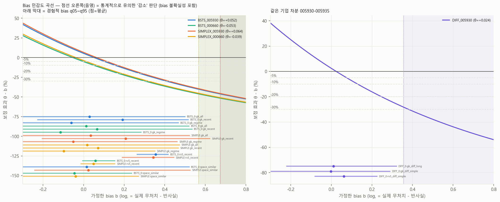
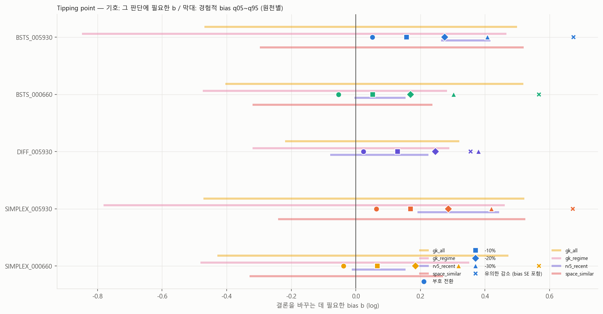
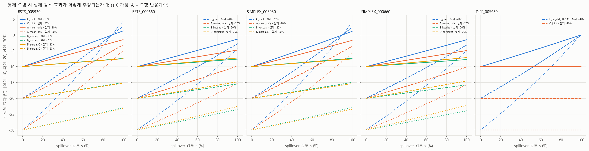
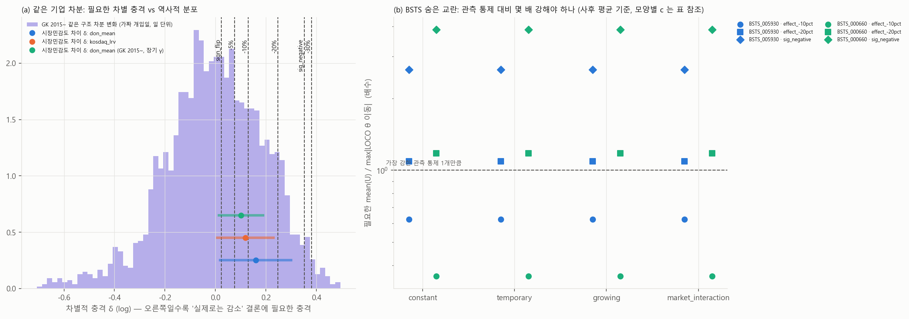
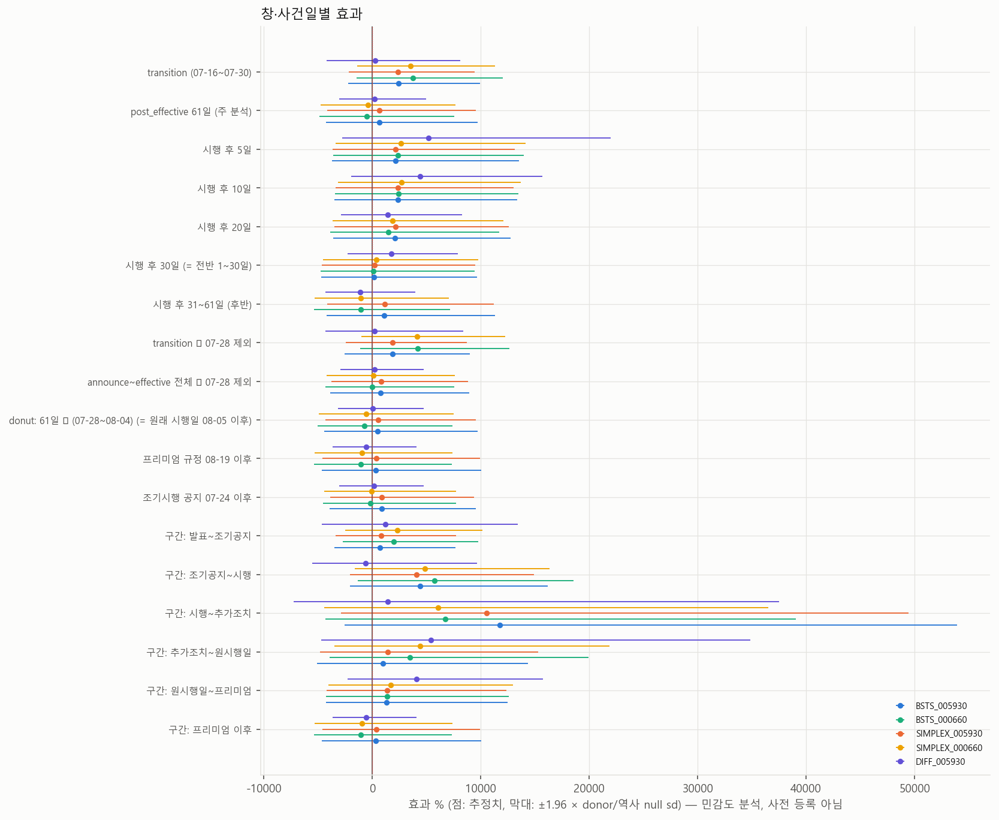
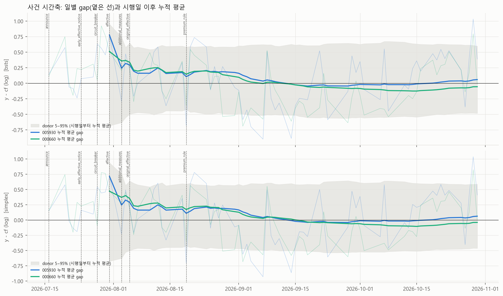
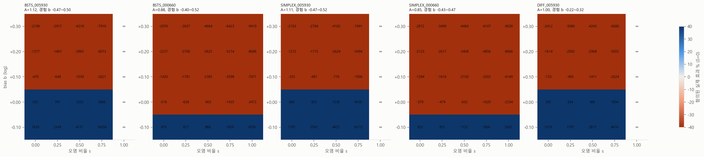
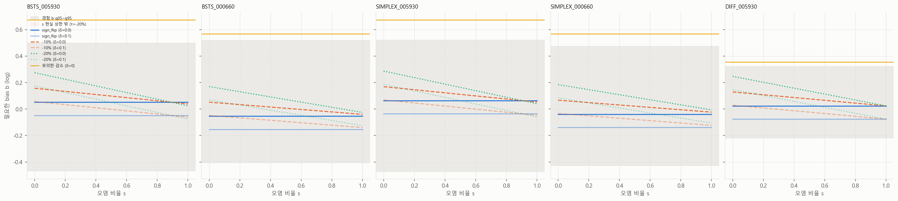

# RQ2 최종 연구 — 민감도 분석과 종합 (sensitivity)

- 작성: 2026-11-17
- 대상: 2026-07 단일종목 레버리지 상품 규제가 005930(삼성전자)·000660(SK하이닉스)의 실현변동성(log RV)에 준 효과
- 주 추정창: 시행 후 61거래일(2026-07-31 ~ 10-30)
- 표기:
  - θ̂ = mean(y − cf) (log), 효과 % = exp(θ) − 1
  - bias b = (실제 무처치 결과 − 반사실). 보정 효과는 θ̂ − b
- 실험 로그 ID: RQ2-S1-\* ~ RQ2-S6-DIAG ([experiment_log.md](experiment_log.md))
- 이 보고서의 창·사건일 분석(§6)은 **사전 등록 분석이 아니라 민감도 분석**이다.

---

## 1. Executive Summary

**한 줄 결론.**
- 61일 동안 두 종목의 변동성이 반사실보다 낮았다는 통계적 증거는 없다. 이 결론은 이번에 점검한 모든 가정 위반에서 유지된다.
- 그러나 "효과가 0이다"나 "감소하지 않았다"는 결론은 아니다.
  - 효과의 **크기와 부호**는 반사실 bias, 통제 구성, 통제 오염 가정에 따라 −10~−20% 감소부터 +10% 이상 증가까지 움직인다.
  - 이 범위는 역사적으로 관찰된 가정 위반의 크기 안에 있다.

| 질문 | 답 | 근거 |
|---|---|---|
| 유의한 감소로 바꾸려면 bias 가 얼마여야 하나 | BSTS·SIMPLEX b ≥ 0.57~0.68, DIFF b ≥ 0.36 | 경험 bias 분포에서 이 크기를 넘는 비율은 ≤ 6% (§3) |
| 부호가 바뀌려면 | 005930 b ≥ 0.05, DIFF b ≥ 0.02. 000660 은 이미 음수 | 경험 bias 의 중앙값 근처 → **부호는 결정할 수 없다** |
| −10% 감소 결론에 필요한 b | 005930 0.16~0.17, 000660 0.05~0.07, DIFF 0.13 | 최근(2024~) GK 가짜 개입 bias 평균 0.19 이내 |
| −20% 감소 결론에 필요한 b | 005930 0.28~0.29, 000660 0.17~0.19, DIFF 0.25 | 경험 범위 안이지만 평균보다 크다 (역사적 상위 약 10~25%) |
| 통제 오염만으로 실제 −20% 가 0 근처로 보이려면 | 005930: donor+KOSDAQ 결합 오염 s ≈ 81%. 000660: s > 100% (불가). DIFF: 005935 가 91% 함께 움직여야 | 005930 은 현실 범위 안 (§4) |
| 관측 통제 구성 | don_mean 을 빼면 BSTS 005930 −18%, kosdaq_lrv 를 빼면 +23% | 결론이 통제 선택에 크게 의존 (§5) |
| 61일 창 MDE (80% 검정력) | BSTS −58%, SIMPLEX −58%, DIFF −38% | −20% 효과의 검정력: BSTS 11%, DIFF 31% (§8) |
| 창·사건일 | 19개 창 모두 보정 후 비유의 (최소 Holm p = 1.0, max-T p ≥ 0.54) | 사건 사이 구간은 따로 식별할 수 없음 (§6) |

**기존 결론과 어긋나거나 그 해석을 약하게 하는 결과** (숨기지 않고 보고한다):
1. **음성통제 보정.** 최근 GK bias(2024~)로 보정하면 결과가 다음과 같다.
   - 처치 종목: 005930 −13.1%, 000660 −11.3%
   - 음성통제 005935: −4.2%(거의 0)
   - 즉 음성통제를 0 근처로 맞추는 보정을 쓰면 처치 종목은 약 −11~−13% 이다. 다만 유의하지 않다.
2. **통제 구성에 대한 민감도(LOCO).** 시장 변동성 대리변수 don_mean 하나를 빼면 다음과 같이 바뀐다.
   - BSTS 005930: +5.3% → −18.2%
   - BSTS 000660: −5.2% → −16.7%
   - 주 분석 추정치는 don_mean 과 kosdaq_lrv 의 반대 방향 영향이 상쇄된 결과다.
3. **같은 기업 차분의 시장 민감도 차이.** 보통주는 우선주보다 시장 변동성 하락에 덜 민감하다(사전 γ = −0.13, HAC se 0.06).
   - 시장이 냉각된 사후기간에는 이 차이 때문에 차분 추정치가 위로 +0.10~0.16 밀렸을 수 있다.
   - 이를 빼면 차분 효과는 −7~−13% 가 된다.
   - 단, don_mean 을 회귀에 직접 넣은 재추정은 −0.6%(p 0.95)로 차이가 작다.
4. **시행 직후 증가.** 시행 직후 5~10일에는 변동성이 반사실보다 +20~50% 높았다(비유의).
   - 07-28 서킷브레이커와 8월 초 급락기와 겹쳐 규제 효과와 분리할 수 없다.
5. **005930 의 사전 추세.** 005930 의 사전 RV 추세는 donor 중 상위 6%(94분위)다. donor 와 교환가능하지 않다.
   - 같은 추세를 가진 005935(94분위)와의 차분이 이를 상쇄하는 유일한 설계다.

**결론 분류** (§10):
- 통계적으로 확인됨: 61일 평균 감소가 **크지 않다**는 것. 95% 수준에서 같은 기업 차분은 약 26~28% 초과, donor 반사실은 약 41~49% 초과 감소를 배제한다 (bias 0 가정).
- 가정 의존: 부호, 그리고 −10~−20% 규모 감소의 유무
- 판단 불가: 사건별 효과, 시행 직후 단기 효과의 원인, 000660 의 방향

---

## 2. Design

### 2.1 기준 추정치 (기존 결과, 수정하지 않음)

| 설계 | θ̂ (log) | % | 보고 p | null (보정용) | null sd | crit95 |
|---|---|---|---|---|---|---|
| BSTS 005930 | +0.052 | +5.3 | 0.88 | 주 분석 placebo-in-space 175 donor | 0.314 | 0.615 |
| BSTS 000660 | −0.053 | −5.2 | 0.86 | 〃 | 0.314 | 0.615 |
| 같은 기업 차분 (005930−005935, HAC DID 상장기간 대비) | +0.024 | +2.4 | 0.76 | 긴 표본 GK 차분 placebo 237 | 0.172 | 0.328 |
| stat_simplex 005930 (bsts .38 / ols .48 / uc .14) | +0.064 | +6.6 | 0.82 | ensemble Exp6 donor 175 | 0.309 | 0.600 |
| stat_simplex 000660 | −0.039 | −3.8 | 0.92 | 〃 | 0.309 | 0.600 |

### 2.2 공통 원칙

- **표본 크기.**
  - n_eff = 고유 가짜 개입일 수 × min(1, 간격/61)을 쓴다. 겹치는 창 수나 bootstrap 반복 수는 표본 크기로 쓰지 않는다.
  - 예: GK 전체 230 창 → n_eff 37.7. rv5 최근 창은 n_eff 0.5 라 SE 를 계산하지 않는다.
- **유의성 기준.** "유의한 감소"는 θ̂ − b < −crit_total 이다.
  - crit_total = √(crit95² + (1.96·se_b)²) 로 bias 추정 불확실성까지 포함한다.
  - 부호 변화와 유의성 변화는 따로 보고한다.
- **재적합 범위.** 새 모형과 재학습은 없다.
  - 통제 오염·LOCO·구조 주입은 주 분석 BSTS(같은 seed·사전분포·반복수)와 통계모형을 다시 적합한다. 총 약 150회이며 결과는 캐시했다.
  - 오염은 사후구간에만 들어가므로 학습 적합은 변하지 않는다. 따라서 θ̂ 은 오염 크기에 정확히 선형이다.
  - 검증 결과: 실제 주입 재적합과 선형식의 차이 ≤ 1e-4, half-shock 선형성 ≤ 2e-4 (§8).
- **창 비교의 기준.** 창 비교(§6)는 ml_ext placebo-in-space 일별 캐시를 다시 평균했다.
  - 이 캐시의 BSTS 61일 효과(005930 0.060)는 주 분석(0.052)과 실행 차이 0.009 가 있다.
  - 이 차이는 null sd 0.31 의 3% 이므로 결론에 영향이 없다.

---

## 3. Bias (Exp1, RQ2-S1-\*)

### 3.1 경험적 bias 원천

가짜 개입일의 61일 평균 예측 오차를 bias 실현값으로 본다. 아래는 BSTS 005930 기준이며, SIMPLEX 는 거의 같다.

| 원천 | 평균 b | sd | n_eff | se(n_eff) | q05 ~ q95 |
|---|---|---|---|---|---|
| GK 2015~ 전체 | +0.029 | 0.317 | 37.7 | 0.052 | −0.47 ~ +0.50 |
| GK 최근 (2024~) | **+0.192** | 0.258 | 8.4 | 0.089 | −0.22 ~ +0.52 |
| GK 같은 regime (고변동·급락) | −0.061 | 0.361 | 7.0 | 0.136 | −0.85 ~ +0.47 |
| rv5 최근 (상장 직전) | +0.355 | 0.056 | 0.5 | 계산 불가 | +0.26 ~ +0.42 |
| space 전체 donor | −0.022 | 0.314 | 175 | 0.024 | −0.50 ~ +0.59 |
| space, 사전 적합이 비슷한 donor 25 | +0.016 | 0.244 | 25 | 0.049 | −0.30 ~ +0.52 |
| GK 2년 이동평균 bias 의 범위 | — | — | — | — | −0.17 ~ +0.19 |

- **000660:** 최근 +0.067, regime −0.114 로 005930 보다 작다.
- **DIFF:** 긴 표본 +0.011(sd 0.173), 단순 차분 −0.002, rv5 +0.062 이다.
- **배경 질문의 "가짜 개입 bias +0.12~+0.20".** 이것은 **최근** 구간 값이다. 전체 역사 평균은 0 근처(+0.01~0.03)다. 어느 구간이 2026-07 에 맞는지는 자료로 정할 수 없다.
- **regime.** 실제 사후기간은 고변동·급락 regime 이다. 같은 regime 의 bias 는 오히려 음수다(반사실이 높게 예측됨). 다만 n_eff 7 로 불확실하다.

### 3.2 별도 기간 검증 (2022~ 가짜 개입일 100개, n_eff 16.4)

bias 를 그 이전 자료만으로 추정해 빼는 보정 5종을 비교했다.

| 설계 | 보정 안 함 RMSE | 최선 보정 (RMSE 비) | 사후 평균 오차 | 95% coverage | FPR |
|---|---|---|---|---|---|
| BSTS 005930 | 0.272 | 모두 ≥ 1.01 (개선 없음) | +0.108 | 0.98~1.00 | ≤ 0.01 |
| BSTS 000660 | 0.271 | regime 0.997 | +0.020 | 0.96~0.97 | ≤ 0.03 |
| SIMPLEX 005930 | 0.293 | 모두 ≥ 1.01 | +0.136 | 0.97~0.99 | ≤ 0.03 |
| DIFF | 0.119 | rolling2y 0.93 | −0.080 | 1.00 | 0 |

- **결론:** 과거 bias 로 보정해도 다음 기간의 오차가 줄지 않는다(DIFF rolling 만 7% 개선).
  - 따라서 특정 bias 값을 "올바른 보정"으로 고를 근거가 없다.
  - bias 는 점추정이 아니라 **범위**로 다루어야 한다.
- **2022~ 의 005930 계열 오차는 평균 +0.11~0.14** 다(반사실 과소예측). 같은 크기의 bias 가 2026-07 에도 있었다면 005930 의 보정 효과는 −5~−7% 다.

### 3.3 Tipping point (필요한 b)

| 설계 | 부호 전환 | −5% | −10% | −20% | −30% | 유의한 감소 (se 미포함 / 포함) | 유의한 증가 (포함) |
|---|---|---|---|---|---|---|---|
| BSTS 005930 | 0.052 | 0.103 | 0.157 | 0.275 | 0.408 | 0.666 / **0.675** | −0.571 |
| BSTS 000660 | (이미 −) | −0.002 | 0.052 | 0.170 | 0.303 | 0.561 / **0.568** | −0.674 |
| SIMPLEX 005930 | 0.064 | 0.115 | 0.169 | 0.287 | 0.421 | 0.664 / **0.673** | −0.545 |
| SIMPLEX 000660 | (이미 −) | 0.013 | 0.067 | 0.185 | 0.318 | 0.561 / **0.568** | −0.645 |
| DIFF | 0.024 | 0.075 | 0.129 | 0.247 | 0.381 | 0.352 / **0.356** | −0.308 |

- **부호 전환.** 필요한 b(0.02~0.06)는 모든 경험 원천의 q05~q95 안에 있다. 경험 bias 의 37~73% 가 이보다 크다. → **부호는 데이터가 정하지 못한다.**
- **−10% 와 −20%.** 모두 경험 범위 안에 있다.
  - −10% 는 GK 최근 평균(0.19) 정도의 bias 면 충분하다.
  - −20% 는 GK 전체 분포에서 상위 약 20~30%(005930) 수준의 bias 가 필요하다.
- **유의한 감소.** 필요한 b 는 BSTS/SIMPLEX 0.57~0.68, DIFF 0.36 이다.
  - 경험 bias 의 ≤ 6% 만 이 값을 넘는다. 2년 이동평균 범위(최대 0.19~0.21)와 사전 적합이 비슷한 donor 의 q95(0.52)도 넘는다.
  - → **"유의하지 않다"는 결론은 현실적인 bias 범위 안에서 유지된다.**
- **유의한 증가.** b ≤ −0.55~−0.67(DIFF −0.31)이 필요하다. 이것도 비현실적이다.

### 3.4 음성통제 보정 (기존 결론과 어긋나는 결과)

같은 bias 원천을 처치 종목과 음성통제(005935, 규제 상품이 없는 우선주)에 똑같이 적용했다(BSTS).

| bias 원천 | 005930 보정 % | 000660 보정 % | 005935 보정 % |
|---|---|---|---|
| GK 전체 | +2.3 | −6.4 | +18.9 |
| **GK 최근** | **−13.1** | **−11.3** | **−4.2** |
| GK regime | +11.9 | +6.3 | +30.1 |
| rv5 최근 | −26.2 | −10.5 | +10.1 |
| space 유사 donor | +3.6 | −0.8 | +19.0 |

- 음성통제를 0 근처(−4%)로 만드는 원천은 "GK 최근" 하나뿐이다. 이 원천으로 보정하면 두 처치 종목 모두 −11~−13% 감소다.
- 다른 원천들에서는 음성통제가 +10~+30% 로 남는다. 이는 그 원천들이 사후기간의 반사실 오차를 과소 반영한다는 뜻이다.
- 따라서 **음성통제가 지지하는 보정을 쓰면 −11~−13% 감소가 가장 그럴듯한 점추정**이다.
- 다만 유의하지 않고, 같은 조정 후 처치−음성통제 격차(005930 −9%)는 같은 기업 차분(+2.4%)과 방향이 다르다.
- rv5 최근 원천은 005930 에만 큰 bias(+0.36)를 준다. 005930 의 강한 사전 상승추세 탓이며, 이 원천의 n_eff 는 0.5 다.

---

## 4. Contamination (Exp2, RQ2-S2-\*)

규제가 donor·KOSDAQ 의 변동성도 함께 낮췄다면(spillover), 반사실도 같이 내려가 효과가 감쇠된다.
오염 비율 s = (통제에 들어간 효과)/(처치 효과 τ)로 정의하면, θ̂ = θ̂₀ + τ(1 − A·s) 이다. A 는 모형의 반응계수다.

### 4.1 반응계수 A (post_effective, 61일)

| 시나리오 | BSTS 005930 | SIMPLEX 005930 | BSTS 000660 | SIMPLEX 000660 |
|---|---|---|---|---|
| A. donor 평균만 (PCA 점수 고정) | 0.86 | 0.84 | 0.54 | 0.52 |
| A2. donor 전체 주입 + PCA 재투영 | 0.85 | 0.83 | 0.63 | 0.62 |
| B. KOSDAQ 만 | 0.27 | 0.27 | 0.25 | 0.23 |
| **C. donor + KOSDAQ 결합** | **1.12** | **1.11** | **0.88** | **0.86** |
| D. 사전 상관 상위 30% donor 만 | 0.26 | 0.25 | 0.28 | 0.30 |
| E. factor β 비례 (재투영) | 0.88 | 0.87 | 0.67 | 0.66 |

- **DIFF:** donor·KOSDAQ 오염에 A = 0 이다(통제를 쓰지 않음). 005935 가 같이 움직이면 A = 1 이다(시나리오 F).
- **점수만 바꾸기 vs 재투영.** PCA 점수만 바꾸는 것(A)과 재투영(A2)은 005930 에서 차이가 거의 없다. 000660 은 재투영 시 A 가 0.54 → 0.63 으로 커진다(don_pc2 가중 때문).
- **A > 1 의 의미.** 005930 은 don_mean 계수가 크다. 결합 오염 시 반사실이 실제 효과보다 **더 많이** 내려가 부호가 뒤집힐 수 있다.

### 4.2 실제 −10/−20/−30% 효과가 "0 근처"(|θ̂| < 0.02)로 보이려면

| 설계 | 시나리오 | −10% | −20% | −30% | 부호 전환 s |
|---|---|---|---|---|---|
| BSTS 005930 | C 결합 | s = 0.72 | **0.81** | 0.84 | 0.89 |
| BSTS 005930 | A donor 평균 | 0.94 | 1.06 (불가) | 1.10 (불가) | 1.17 |
| BSTS 005930 | B KOSDAQ / D 부분 | ≥ 3.0 (불가) | 불가 | 불가 | ≥ 3.7 |
| BSTS 000660 | C 결합 | 0.93 | 1.04 (불가) | 1.08 (불가) | 1.14 |
| BSTS 000660 | 그 외 | ≥ 1.2 (불가) | 불가 | 불가 | — |
| DIFF | F 005935 오염 | 0.81 | 0.91 | 0.94 | 1.00 |

SIMPLEX 는 BSTS 와 ±0.03 이내다.

### 4.3 현실성

- **상한.** 미국 변수만으로 만든 반사실 대비 donor 평균의 사후 변화는 +0.20(null sd 0.22)이다(주 분석 §6.2). 95% 하한은 −0.24 이다.
  - 따라서 donor 가 규제 때문에 낮아질 수 있는 최대 폭은 약 −0.24(−21%)다.
  - 실제 효과가 −20%(τ = −0.22) 이하이면 s = 1 까지 이 상한 안에 든다.
  - → **005930 에서 "실제 −20% 효과가 결합 오염 81% 로 0 근처로 보였다"는 시나리오는 현재 자료로 배제할 수 없다.**
- **반대 근거.** 미국 기반 반사실 대비 donor 평균의 점추정은 **증가**(+0.20)다. 규제로 donor 가 냉각되었다는 직접 증거는 없다.
  - 국내 donor 평균은 상장기간 대비 −1.24 sd 낮아졌지만, 이는 시장 전체 냉각으로도 설명된다.
- **000660.** 단일 시나리오로는 −20% 를 0 근처로 만들 수 없다(s > 1 필요).
  - θ̂ 가 이미 음수이므로 오염은 감소를 **키우는** 쪽으로 해석된다(C 결합 s = 0.75 → 함의 효과 −14%, s = 1 → −35%).
- **DIFF.** 005935 가 005930 효과의 91% 만큼 같이 움직여야 −20% 가 0 으로 보인다.
  - 보통주·우선주 차익 연계로 일부 동조는 가능하다. 그러나 우선주에는 단일종목 레버리지 상품이 없다.
  - 이 정도 동조를 판단할 자료(우선주 수급)는 없다.
- **검정 특성.**
  - 오염은 τ = 0 일 때 추정치를 바꾸지 않는다. 따라서 FPR 은 변하지 않는다.
  - 검정력은 −20% 기준 BSTS 0.11 → s = 0.5 에서 0.05, DIFF 0.31 → 0.09 로 떨어진다.
  - coverage 는 s = 1 에서 0.88(BSTS)~0.76(DIFF)까지 떨어진다.

---

## 5. Confounding (Exp3, RQ2-S3-\*)

### 5.1 같은 기업 차분: 보통주에만 온 규제 외 충격 δ

관측 θ̂ = τ + δ 이다. "실제로는 x% 감소"가 되려면 δ = θ̂ − log(1+x) 가 필요하다.
역사적 분포는 GK 2015~ 의 같은 구조 차분 변화(34일 기준창 → 사후 [10, 71) 창, 일 단위 가짜 개입 2,720개, n_eff 44.6)다.

| 결론 | 필요한 δ | 역사적 P(D ≥ δ) 단순차분 / 주 분석 긴 표본 placebo |
|---|---|---|
| 부호 전환 | 0.024 | 0.45 / 0.39 |
| −5% | 0.075 | 0.35 / 0.30 |
| −10% | 0.129 | 0.26 / 0.23 |
| −20% | 0.247 | 0.10 / 0.10 |
| −30% | 0.381 | 0.014 / 0.030 |
| 유의한 감소 | 0.352 | 0.025 / 0.034 |

δ 의 크기를 가늠하는 비교 대상:

| 비교 대상 | δ 추정 |
|---|---|
| 사전 추세 (월 기울기 × 기준창~사후창 중심거리 2.8개월) | rv5 전체 +0.013, rv5 상장 전 +0.055, GK 전체 −0.042, GK 상장 전 −0.045 |
| **시장 민감도 차이** (d 를 don_mean 에 회귀, 사전 γ × 사후 don_mean 변화 −1.24) | **+0.159** (95% +0.02~+0.30) |
| 〃 kosdaq_lrv (변화 −2.18) | +0.119 (+0.01~+0.23) |
| 〃 GK 2015~ 장기 γ | +0.102 (+0.01~+0.19) |

관측 교란을 회귀에 직접 넣은 재추정:

| 사양 | θ̂ | p |
|---|---|---|
| 주 분석 (gap_day) | +0.024 | 0.79 |
| + don_mean | −0.007 | 0.95 |
| + kosdaq_lrv | +0.012 | 0.90 |
| + don_mean, kosdaq_lrv, us_lvix | −0.014 | 0.89 |

해석:
- **부호 전환과 −10% 수준은 역사적으로 흔한 충격**(23~45%)으로 충분하다. −20% 는 상위 10%, 유의한 감소는 상위 2.5~3.4% 의 충격이 필요하다.
- **시장 민감도 차이는 측정 가능한 교란이다.** 보통주는 시장 변동성에 덜 민감하다(γ < 0). 사후기간 시장 냉각기에 차분이 위로 +0.10~0.16 밀렸다.
  - 사전 γ 로 외삽하면 차분 효과는 −7~−13% 다. 방향은 감소이고 크기는 역사적 −10% tipping 근처다.
  - 그러나 같은 표본에서 don_mean 을 직접 통제하면 효과는 −0.6% 로 거의 0 이다.
  - 사전 γ 외삽과 직접 통제의 차이는 γ 가 사후에 안정적이라는 가정에 달려 있다.
- **사전 추세.** 차분의 사전 추세는 측정(rv5/GK)에 따라 부호가 다르고 크기가 작다(|δ| ≤ 0.055).
  - 차분은 005930 의 강한 상승추세(donor 94분위)를 거의 완전히 상쇄한다. 이것이 차분 설계의 가장 큰 장점이다.

### 5.2 BSTS 숨은 교란 U_t

사후에만 처치 종목에 더해지고 통제와 무관한 U_t 를 가정한다. 사후 y 를 학습하지 않으므로 θ̂ 에 그대로 전달된다(θ̂ = τ + mean U).

| 모양 | mean(U)/c | 005930 −20% 에 필요한 c | 000660 −20% 에 필요한 c |
|---|---|---|---|
| constant | 1 | 0.275 | 0.170 |
| temporary (첫 10일) | 0.164 | 1.68 | 1.04 |
| growing (0 → c 선형) | 0.5 | 0.55 | 0.34 |
| market_interaction (c·z_t, z = 표준화 don_mean) | −0.09 | −3.06 (부호 반대, 비현실) | −1.89 |

**기준: 관측 통제 하나만큼 강한 교란 (LOCO 재적합 θ̂ 이동)**

| 뺀 통제 | BSTS 005930 Δθ̂ | BSTS 000660 Δθ̂ | OLS 005930 | OLS 000660 |
|---|---|---|---|---|
| **don_mean** | **−0.252** (→ −18.2%) | −0.129 (→ −16.7%) | −0.204 | −0.122 |
| **kosdaq_lrv** | **+0.151** (→ +22.6%) | +0.145 (→ +9.5%) | +0.175 | +0.143 |
| don_pc2 | +0.003 | −0.054 | −0.001 | −0.177 |
| us_lvix | +0.014 | −0.005 | +0.086 | −0.049 |
| don_pc3, us_abs_sox, gap_day | ≤ 0.011 | ≤ 0.011 | ≤ 0.026 | ≤ 0.008 |

- **constant 교란 기준.** −20% 결론에는 가장 강한 관측 통제의 1.09배(005930) / 1.18배(000660)인 교란이 필요하다. 유의한 감소에는 2.6배 / 3.9배가 필요하다.
  - 즉 **don_mean 정도 강도의 누락 변수 하나**면 −10~−20% 감소 결론이 가능하다. 유의성까지는 그 2.6배 이상이 필요하다.
- **일시 교란.** 서킷브레이커 같은 10일 교란으로 61일 결론을 바꾸려면 c ≥ 1~1.7(log)이 필요하다. 일별 RV 가 2.7~5배 움직여야 하는 크기다.
- **시장 상호작용형 교란.** 사후 61일 동안 표준화 don_mean 의 평균이 사전 평균과 비슷해(−0.09) 거의 상쇄된다. 이 모양으로는 결론이 바뀌지 않는다.
- **LOCO 결과 자체가 중요한 발견이다.** 주 분석 θ̂ ≈ 0 은 don_mean(음의 방향)과 kosdaq_lrv(양의 방향)가 서로 상쇄한 결과다. 둘 중 무엇을 신뢰하느냐에 따라 −18% ~ +23% 가 나온다.
  - 주 분석 사양(C_main)은 사전에 정한 것이고 이 실험은 그것을 바꾸지 않는다.
  - 그러나 **결론이 통제 사양에 강하게 의존**한다는 점은 논문에 밝혀야 한다.
- **Oster δ / Cinelli-Hazlett.**
  - 두 방법은 OLS 의 R² 변화 논리에 기반한다. 상태공간 모형에 변수 선택(spike-and-slab)을 쓰는 BSTS 에는 그대로 옮길 수 없다.
  - 그래서 같은 질문을 "관측 통제 k 만큼 강한 교란"(LOCO)으로 바꿔 답했다.
  - 참고로만 사후 더미 OLS-ITS 를 계산했다(s3_ols_cinelli_hazlett_reference): 005930 계수 +0.166(t = 2.05, RV_q=1 = 0.12), 000660 +0.094(t = 1.18, RV = 0.07).
  - 이 OLS-ITS 는 주 분석과 다른 모형(사후 더미가 반사실을 정의)이다. 양의 계수는 주 분석 결론의 근거로 쓰지 않는다.

---

## 6. Event & Window (Exp4, RQ2-S4-\*) — 민감도 분석, 사전 등록 아님

공통 설정:
- 창 19개(기준 2개 제외)를 비교했다.
- p 는 같은 창 donor null 대비 중심화 경험 p 다. 보정은 설계별 Holm·BH 와 donor 벡터 max-|z| 를 썼다.
- DIFF 는 rv5 차분의 창 평균 − 상장기간 평균이고, null 은 GK 긴 표본의 같은 상대 위치다.

| 창 | BSTS 005930 | BSTS 000660 | SIMPLEX 005930 | SIMPLEX 000660 | DIFF |
|---|---|---|---|---|---|
| transition (07-16~07-30) | +23.9% | +37.4% | +23.3% | +35.2% | +2.4% |
| 61일 (주 분석, space 캐시) | +6.2% | −5.3% | +6.6% | −3.8% | +1.9% |
| 시행 후 5일 | +46% | +24% | +21% | +27% | +52% |
| 시행 후 10일 | +36% | +24% | +24% | +27% | +44% |
| 시행 후 20일 | +23% | +15% | +21% | +18% | +14% |
| 시행 후 30일 (= 전반) | +2~5% | +0.7% | +2.1% | +3.6% | +17% |
| 후반 31~61일 | +9% | −10.7% | +11.2% | −10.5% | −11.2% |
| donut (07-28~08-04 제외 = 08-05 이후) | 비슷 | −7.3% | +5.1% | −5.9% | +0.2% |
| 08-19 이후 | — | −10.8% | +3.6% | −9.6% | −5.8% |
| 최소 p (보정 전) | 0.11 | 0.13 | 0.13 | 0.13 | 0.22 |
| 최소 Holm / BH / max-T p | 1.0 / 0.98 / 0.56 | 1.0 / 0.99 / 0.55 | 1.0 / 0.96 / 0.62 | 1.0 / 0.99 / 0.54 | 1.0 / 0.99 / 0.77 |

정확한 값은 [tables/s4_event_window.csv](tables/s4_event_window.csv) 에 있다.

- **유의한 창은 없다.** 다중검정 보정 전에도 최소 p 는 0.11 이다.
- **시간 모양.** 시행 직후 증가(+20~50%)에서 후반 감소(000660·DIFF −10~−11%)로 단조롭게 내려간다.
  - 005930 BSTS 는 후반에도 + 다. 005930 의 사전 추세가 반사실을 계속 밑돌게 만들기 때문으로 보인다.
  - 이 모양이 시차를 둔 규제 효과일 수도 있다. 혹은 8월 초 급락기 고변동이 해소되는 과정(평균 회귀)일 수도 있다. 이 자료로 둘을 구별할 수 없다.
- **07-28 서킷브레이커.** 제외해도 transition 효과가 줄지 않는다(005930 +24% → +19~24%). 하루짜리 사건이 transition 결과를 만든 것은 아니다.
- **사건 사이 구간의 식별.** 구간이 2~11거래일로 짧다. MDE(80%, 2.8 × null sd)가 −51~−87% 다.
  - 모든 구간이 −20% 효과를 식별할 수 없다(identifiable_20pct = False 전부).
  - 07-24 조기시행 공지, 08-03 추가조치, 08-05 원래 시행일, 08-19 괴리율 규정의 효과는 **따로 식별할 수 없다**.
- 창 선택으로 부호를 바꿀 수 있다. 예: 000660 은 시행 후 20일이면 +15%, 08-19 이후면 −11% 다. 그래서 창 선택은 사전 지정(61일)을 유지해야 한다.

---

## 7. Joint (Exp5, RQ2-S5-\*)

가산식은 θ̂ = τ(1 − A·s) + b + δ, 즉 τ = (θ̂ − b − δ)/(1 − A·s) 이다.

- **b 와 δ 의 구분.**
  - b 의 경험 분포는 가짜 개입일에서 왔으므로 평범한 교란을 이미 포함한다.
  - 따라서 δ 는 그 위의 **초과 교란**으로만 해석한다. 같은 교란을 두 번 빼지 않기 위해서다.
- **유의성.** s 와 무관하다. b + δ > crit_total + θ̂ 일 때만 유의한 감소다.

| 설계 | A (시나리오) | 경험 b q05~q95 | 격자 셀 (b ∈ [−0.1, 0.3], s ∈ [0, 1], δ ∈ [−0.1, 0.2]) 중 τ < 0 | τ ≤ −10% | τ ≤ −20% | 유의한 감소 |
|---|---|---|---|---|---|---|
| BSTS 005930 | 1.12 (C) | −0.47 ~ 0.50 | 56% | 48% | 36% | **0%** |
| BSTS 000660 | 0.88 (C) | −0.40 ~ 0.52 | 85% | 76% | 65% | **0%** |
| SIMPLEX 005930 | 1.11 (C) | −0.47 ~ 0.52 | 56% | 44% | 32% | **0%** |
| SIMPLEX 000660 | 0.85 (C) | −0.43 ~ 0.47 | 85% | 76% | 65% | **0%** |
| DIFF | 1.00 (F) | −0.22 ~ 0.32 | 56% | 48% | 40% | 15% (b + δ ≥ 0.4 인 셀) |

격자 셀 비율은 격자 범위에 따라 달라지는 기술 통계이며 확률이 아니다.

- **frontier (δ = 0).** s 가 커질수록 필요한 b 가 줄어든다.
  - 005930 에서 s = 0.8 이면 b ≈ 0.05 만으로 −20% 결론이 가능하다.
  - 000660 은 s = 0.5 이면 b ≈ 0.07 로 −20% 가 가능하다.
- **유의성은 어떤 결합에서도 BSTS·SIMPLEX 에서 나오지 않는다.** 필요 b 가 0.57~0.68 로 격자 상한(0.3)과 경험 q95 를 넘는다.
- **DIFF 의 유의성.** b + δ ≥ 0.36 인 경우, 예컨대 b = 0.2(최근 GK 수준)와 δ = 0.16(시장 민감도 외삽)의 조합에서만 유의해진다.
  - 이 조합은 b 와 δ 가 같은 시장 냉각을 두 번 반영할 위험이 있다. b 의 원천(최근 GK)이 이미 시장 국면을 포함하기 때문이다.
  - 따라서 **현실적인 단일 해석으로 보지 않는다.**
- **구조 주입 검증.** BSTS 에 y += τ + δ + b, 통제에 s·τ 를 실제로 넣고 재적합했다(2종목 × 2셀). 가산식과의 차이는 < 1e-4, τ 복원 오차는 ≤ 1e-4 다.
  - 이 설계에서 가정들은 실제로 가산적이다. 상호작용은 없다.
  - 사후 y 가 학습에 쓰이지 않고 오염이 사후 X 에만 들어가기 때문이다.

---

## 8. Diagnostics & Limitations

### 8.1 진단

| 항목 | 결과 |
|---|---|
| 61일 MDE (80% 검정력) | BSTS −58%, SIMPLEX −58%, DIFF −38% |
| −10 / −20 / −30% 효과 검정력 | BSTS 0.06 / 0.11 / 0.21. DIFF 0.08 / 0.31 / 0.64 |
| donor 교환가능성 (donor 분포 내 분위) | 005930: 사전 RMSE 9분위, 수준 27분위, **추세 94분위**. 000660: 15 / 65 / 51분위. 005935: 25 / 33 / **94분위** |
| 실행 간 차이 (주 분석 vs space 캐시 BSTS) | post_effective 005930 +0.009, 000660 −0.001 |
| Exp2 선형성 / 주입 재적합 vs 선형식 | 최대 2e-4 / < 1e-4 |
| Exp5 구조 주입 vs 가산식 / τ 복원 오차 | < 1e-4 / 1e-4 |
| 2022~ 별도 기간 bias 보정 | RMSE 개선 없음 (DIFF rolling 만 0.93) |

### 8.2 한계

1. **측정 단위 불일치.** 긴 표본 bias(GK, 일봉 기반)는 주 분석의 측정(rv5, 5분봉)과 다르다.
   - rv5 의 같은 길이 가짜 개입 창은 n_eff 0.5 로 사실상 하나뿐이다. bias 범위는 GK 를 빌려 쓴 근사다.
2. **검정력이 근본 제약이다.**
   - BSTS 는 61일 평균 −58% 이상, DIFF 는 −38% 이상의 감소만 80% 확률로 잡는다.
   - −10~−20% 규모 효과는 있든 없든 이 자료로 검정할 수 없다. 이번 민감도 분석은 이 사실을 여러 방향에서 다시 확인한 것이다.
3. **통제 오염의 현실성 상한.** 상한이 미국 변수 반사실 하나(null sd 0.22)에 의존한다. donor 오염을 직접 측정할 자료(donor 종목의 레버리지 수급)는 없다.
4. **같은 기업 차분의 가정.** 005935 가 규제의 영향을 받지 않는다는 가정은 검정할 수 없다.
   - 보통주·우선주 시장 민감도 차이를 어떻게 다루느냐에 따라 −0.6%(직접 통제)와 −7~−13%(사전 γ 외삽)가 갈린다.
5. **통제 사양 의존성.** LOCO 로 −18% ~ +23% 가 나온다. 사전 지정 사양을 유지했지만, 다른 합리적 사양에서 결론의 크기가 크게 달라질 수 있다.
6. **동시 사건.** 07-28 서킷브레이커와 8월 초 급락기, 실적발표, 옵션만기를 통제하지 못했다. 사건 사이 구간은 너무 짧아 분리할 수 없다.
7. **격자 결과의 해석.** 격자 셀 비율(§7)은 사전 분포가 아니다. 각 가정 위반의 사전 확률을 정할 근거가 없어 베이지안 결합은 하지 않았다.
8. **다중 비교.** 이 보고서에는 수백 개의 수치가 있다. 사전 지정 결론은 주 분석 61일 추정 하나뿐이며, 이 실험의 어떤 개별 셀도 새로운 주장의 근거로 쓰지 않는다.

---

## 9. Implications for Paper

### 9.1 본문에 넣을 것

1. **결론 문장.**
   - 권장: "시행 후 61거래일 동안 두 종목의 실현변동성이 반사실보다 낮았다는 통계적 증거는 없다. 같은 기업 차분 기준 약 28% 초과 감소는 배제되지만, 10~20% 수준의 감소는 배제할 수 없다."
   - "효과가 없었다"는 문장은 쓰지 않는다.
2. **유의성 tipping 표 (§3.3 요약).**
   - 유의한 감소에 필요한 bias: BSTS 0.57~0.68, DIFF 0.36
   - 경험 bias 분포에서 이를 넘는 비율: ≤ 6%
   - 부호 전환에 필요한 bias: 0.02~0.06 (흔함)
   - 한 줄 메시지: 유의성 결론은 견고하고, 부호는 결정되지 않는다.
3. **검정력·MDE 한 문단 (§8.1).**
4. **같은 기업 차분의 장점과 한계 한 문단.**
   - 장점: 005930 의 비교환적 사전 추세를 상쇄하고, 통제 오염에 면역이며(A = 0), null sd 가 가장 작다(0.17).
   - 한계: 005935 동조(s = 0.91 이면 −20% 가 0 으로 보임)와 시장 민감도 차이(+0.10~0.16)에 취약하다.
5. **음성통제 보정 결과 (§3.4) 한 줄.** 기존 결론과 긴장 관계이므로 본문에서 숨기지 않는다.
   - "음성통제를 0으로 맞추는 bias 보정을 적용하면 처치 종목의 점추정은 −11~−13% 이나 유의하지 않다."

### 9.2 부록에 넣을 것

- bias 원천 표와 별도 기간 검증 (§3.1~3.2), 오염 반응계수 표와 곡선 (§4), LOCO 표와 숨은 교란 모양별 c (§5.2)
- 창·사건일 forest plot과 사건 구간 MDE (§6). "사전 등록 아님"을 명시한다.
- 결합 heatmap·frontier, 구조 주입 검증 (§7), 진단표 (§8.1)
- OLS 판 Cinelli-Hazlett 값은 참고 각주로만 넣는다. 주 분석 모형과 다르다.

### 9.3 005930 과 000660 의 차이 (본문에서 구분)

| | 005930 | 000660 |
|---|---|---|
| 점추정 부호 | + (+5~7%) | − (−4~−5%) |
| −10% 결론에 필요한 b | 0.16~0.17 | 0.05~0.07 |
| 경험 bias 와의 관계 | 최근 GK 평균(0.19) 정도 필요 | 전체 평균(0.01)보다 약간 크면 충분 |
| 통제 오염의 방향 | A > 1: 결합 오염 81% 면 −20% 가 0 근처. 89% 이상이면 부호 반전 | A < 1: 오염은 감소를 키우는 쪽 (s = 0.75 → −14%) |
| donor 교환가능성 | 사전 추세 94분위 (비교환적) | 중간 (51분위) |
| 같은 기업 대조 | 있음 (005935) | 없음 |
| 해석 | 감소 증거가 더 약하다. 차분 설계가 있어 가장 엄밀하게 점검된 종목이다 | 점추정은 감소 방향이지만 검정력은 똑같이 부족하다. 대조 설계가 하나뿐이다 |

### 9.4 RQ4 와의 연결

- RQ2 의 null 은 "변동성 효과가 없었다"가 아니라 **"이 자료의 검정력으로는 −20% 이하 효과를 볼 수 없다"**는 뜻이다.
- RQ4 는 규제 후 비규제 국내 레버리지 상품의 개인 거래활동 변화를 다룬다. 이것이 RQ2 null 의 해석을 정하는 1단계 증거가 된다.
  - **RQ4 에서 수요가 국내 비규제 상품으로 크게 이동했다면:** 단일종목 레버리지의 리밸런싱 주문흐름이 대체 상품을 통해 일부 유지되었을 수 있다. 그러면 RQ2 의 작은 효과는 "경로가 유지되었기 때문"으로 해석된다.
  - **이동이 작았다면:** 단일종목 레버리지 수요 자체가 사라졌거나 해외로 이동한 것이다. 그러면 RQ2 의 가능한 효과 범위(−10~−20%)를 어느 쪽으로 읽을지가 1단계 크기에 달려 있다.
- **넘겨줄 실무 교훈.**
  1. RQ4 도 같은 기간·같은 사건 타임라인을 쓴다. 사건 사이 구간은 분리 식별이 어렵다는 이 실험의 결과(§6)가 그대로 적용된다.
  2. 평행추세 점검에서 처치 상품의 사전 추세 분위를 donor 분포 안에서 보고한다(§8.1 방식).
  3. 통제군 오염(지수형 상품도 규제 영향을 받는 경우)을 Exp2 처럼 반응계수로 정량화할 수 있다.

---

## 10. Final RQ2 Conclusion

### 10.1 통계적으로 확인된 것

- 61일 평균 효과는 다음 범위에 있다. 이는 이번 분석의 모든 설계·창·사건일·다중검정 보정에서 **유의한 감소도 유의한 증가도 아니다**.
  - BSTS: 005930 +5.3%, 000660 −5.2%
  - 같은 기업 차분: +2.4%
  - stat_simplex: +6.6% / −3.8%
- 이 비유의 결론은 현실적인 가정 위반 범위에서 유지된다. 다음 조건 중 하나가 있어야 유의한 감소가 된다.
  - bias ≥ 0.57~0.68 (BSTS/SIMPLEX) 또는 ≥ 0.36 (DIFF). 경험 분포 상위 6% 이내.
  - 가장 강한 관측 통제의 2.6~3.9배인 숨은 교란
  - 역사적 상위 2.5~3.4% 의 보통주 고유 충격
- 95% 수준에서 배제되는 감소 (bias 0 가정): 같은 기업 차분 약 26~28% 초과, BSTS 005930 43%·000660 49% 초과, SIMPLEX 42%·47% 초과. 80% 검정력 MDE 는 이와 다른 개념으로 DIFF −38%, BSTS −58% 다.

### 10.2 가정에 따라 달라지는 것

- **효과의 부호.**
  - bias 0.02~0.06, 또는 역사적으로 흔한(23~45%) 차별 충격만으로 바뀐다.
  - 통제 사양(don_mean 또는 kosdaq_lrv 제외)으로 −18% ~ +23% 가 된다.
- **−10~−20% 감소의 유무.** 다음 각각이 이 결론을 만든다. 각각 역사적·물리적으로 가능한 범위 안에 있다.
  - 최근 GK 수준의 bias (+0.19). 음성통제 보정이 지지하는 값이다.
  - 005930 에서 donor·KOSDAQ 의 81% 결합 오염
  - 보통주·우선주 시장 민감도 차이의 사전 γ 외삽 (+0.10~0.16)
  - 가장 강한 관측 통제 정도의 누락 교란
- **시간 모양.** 직후 증가 → 후반 감소. 창 선택에 따라 부호가 다르다.

### 10.3 판단할 수 없는 것

- −10~−20% 규모 효과가 실제로 있었는지 없었는지 (검정력 0.06~0.31)
- 개별 사건(07-24 공지, 08-03 추가조치, 08-05, 08-19 괴리율 규정)의 분리 효과 (구간 MDE −51~−87%)
- 시행 직후 변동성 증가가 규제 때문인지, 07-28 서킷브레이커·8월 초 급락 때문인지
- 000660 의 효과 방향. 점추정은 음수지만 같은 기업 대조가 없고 검정력이 같은 수준이다.
- 통제 오염의 실제 크기. donor 의 레버리지 수급 자료가 없다.

### 10.4 할 수 있는 주장 / 할 수 없는 주장

| 할 수 있다 | 할 수 없다 |
|---|---|
| "61일 동안 반사실 대비 변동성 감소의 통계적 증거는 없다" | "규제는 변동성에 효과가 없었다" |
| "큰 평균 감소(같은 기업 차분 기준 약 28% 초과)는 자료와 맞지 않는다" | "규제가 변동성을 낮추지 않았다" / "높였다" |
| "이 결론은 현실적인 bias·오염·교란 범위에서 유지된다" | "효과의 부호는 양(+)이다" (005930) 또는 "음(−)이다" (000660) |
| "10~20% 수준 감소는 배제되지 않으며, 그 판단은 bias·통제 사양·오염 가정에 달려 있다" | "시행 직후 변동성이 규제 때문에 증가했다" |
| "음성통제를 맞추는 보정에서는 −11~−13% 점추정이 나오나 유의하지 않다" | "08-19 이후 효과가 나타났다" 등 창·사건 선택에 기반한 주장 |

**RQ2 는 여기서 종료한다.**
- 사후 표본이 늘면(2027-01 이후) 같은 사전 지정 설계(61일 → 연장 창, C_main, 같은 null)를 다시 돌린다. 이 보고서의 tipping 표를 같은 방식으로 갱신하는 것이 유일한 후속 작업이다.
- 다음 연구는 RQ4 이며, §9.4 의 연결을 출발점으로 삼는다.
